# Projecting, Simulating and Drafting: A Statistical Model for a 10-Team, 9-Category Head-to-Head Fantasy Basketball League

<p class="meta">A personal applied-statistics project, written up as a technical report<br>
Prepared 16 October 2026 · League: ESPN snake draft, 10 teams, 9 categories, head-to-head (most categories wins the week) · Season projected: 2026-27</p>

<div class="abstract" markdown="1">

**Abstract.** This report documents a draft assistant for a single fantasy-basketball league, built in three phases and tested on seasons it had not seen. *Phase 1* projects the 2026-27 per-game statistics of every player from 281,164 player-games of box scores (2015-16 to 2025-26) using a shrinkage (empirical-Bayes) baseline, regularised and gradient-boosted corrections chosen by a walk-forward backtest, a purpose-built definition of *availability*, team-context features, a rookie prior and four documented expert judgments. On 1,668 out-of-sample player-seasons the projections beat "same as last year" in all nine categories and ranked better in every one of five test seasons (mean Spearman correlation with true fantasy value 0.675 against 0.619). *Phase 2* converts projections into thousands of simulated weeks on the real 2026-27 calendar (negative-binomial counts, a Gaussian copula for dependence between statistics, whole-week absences); on four past seasons the simulated weekly spread was about 5% too narrow while the category dependence and matchup probabilities were well calibrated. *Phase 3* chooses each pick by rolling out the rest of the draft and maximising the probability of winning a weekly matchup; on real box scores from 2021-22 to 2025-26 the final pick policy gained an average of **+5.2 points of weekly win probability** over "take the best player left" (standard error 1.2, positive in 5 of 5 seasons). The projected ranking correlates 0.75 with the market's average draft position; the main disagreements are structural (assumed absences, returners from missed seasons, young big men, aging guards) rather than random. The report also documents the places where the models had to be reconsidered, including the case of Giannis Antetokounmpo, who started at 93rd and finished at 6th after three separately justified changes.

</div>

## Key findings at a glance

* **Projection accuracy.** Out-of-sample, the projections reduce mean absolute error in all nine categories and improve the ranking of players in 5 of 5 test seasons (Spearman 0.675 vs 0.619). Learned corrections help for minutes, shot attempts and availability and are rejected where they do not beat the baseline (rebounds, steals, free-throw %).
* **Availability is the largest source of error** and its definition matters more than any model: counting only games after a player's first appearance and treating known absences as inputs removes most of the systematic bias.
* **A pure z-score sum misleads at the extremes.** Flooring each category's z-score at −3 changes nobody in the top 150 except Giannis Antetokounmpo, whose free-throw percentage is an extreme outlier; together with two other documented changes it moved him from 103rd to 6th (section 8.3).
* **The simulation is reliable for ranking decisions, not for absolute probabilities**: its weeks are about 5% too narrow and its matchup probabilities about 5% too extreme.
* **Draft policy.** A category-aware policy beat "best available" by +5.2 points of weekly win probability on real seasons (about +0.9 wins over the 18-week regular season). An early lead for the policy over the plain engine disappeared at full sample, and looking at all 200 candidates does not help (sections 10.6-10.7).
* **Against the market.** Rank correlation 0.75; median gap 25 places in the drafted range. The model is lower on assumed-absent players, returners from missed seasons and young bigs, and higher on efficient role players (section 11).
* **Where to go next: role.** A first look at the box scores (section 14) suggests that players back from a missed season lose minutes but not usage per minute (part-season returners lose some usage too), that minutes are restricted for about ten games after a layoff (about two games' worth in total), that stayers' usage rises when a *high-usage* teammate leaves but not when role players do, and that same-position crowding costs guards and centers minutes beyond what the projection knows.

**The model's top 12 for 2026-27, with the market's order alongside**

| our rank | player | age | proj PPG | proj GP | market order |
|---|---|---|---|---|---|
| 1 | Shai Gilgeous-Alexander | 28 | 31.3 | 69 | 4 |
| 2 | Nikola Jokić | 32 | 26.1 | 67 | 1 |
| 3 | Victor Wembanyama | 23 | 24.5 | 57 | 2 |
| 4 | Luka Dončić | 28 | 30.5 | 61 | 3 |
| 5 | Tyrese Maxey | 26 | 26.2 | 60 | 11 |
| 6 | Giannis Antetokounmpo | 32 | 28.2 | 65 | 6 |
| 7 | Scottie Barnes | 25 | 19.3 | 65 | 13 |
| 8 | Donovan Mitchell | 30 | 26.0 | 62 | 12 |
| 9 | Anthony Edwards | 25 | 28.5 | 65 | 7 |
| 10 | Jamal Murray | 30 | 23.5 | 63 | 22 |
| 11 | Derrick White | 32 | 17.8 | 68 | 39 |
| 12 | Trey Murphy III | 27 | 20.3 | 63 | 43 |

## Contents

1. Introduction (purpose, why this is a statistics problem, overview)
2. Data and sources
3. Phase 1, step 1: the player-season table and a shrinkage baseline
4. Phase 1, step 2: learned corrections and how they were tested (walk-forward backtest, residual diagnostics)
5. Phase 1, step 3: availability, the biggest source of error
6. Phase 1, step 4: team context
7. Rookies and expert inputs
8. Phase 1, step 5: from projections to a ranking (the value score and the Giannis dilemma)
9. Phase 2: from an average to a distribution of weeks (simulation and its realism test)
10. Phase 3: from distributions to a draft decision (engine, pick policy, validation on real seasons)
11. Results: the 2026-27 board against the market
12. Last season's biggest jumpers and fallers
13. Conclusion
14. Next steps: areas to explore (role and usage after injury, roster change, positional depth, recommendations and questions)
- References
- Appendices: A. Reproducing the results · B. Fitted parameters · C. League settings · D. Glossary

# 1. Introduction

## 1.1 Purpose

This project builds a **fantasy-basketball draft assistant** for one specific league: an ESPN snake draft with 10 teams, nine scoring categories (points, three-pointers made, rebounds, assists, steals, blocks, field-goal percentage, free-throw percentage and turnovers), and **head-to-head weekly matchups in which only the result matters**. A team wins its week by beating its opponent in more than 4.5 of the nine categories; the margin is irrelevant. Lineups are set daily into ten active slots (PG, SG, G, SF, PF, F, C and three UTIL), there are three bench spots, a roster may hold at most three centers, and the season is 18 regular-season weeks followed by three playoff weeks.

The purpose is deliberately narrow: *for each pick, tell me which of the top-200 players gives my team the best chance of winning*, assuming everyone keeps the roster they draft all season (no waiver pickups or trades; those are deliberately out of scope). The project is a personal one, but it is written up here like a small applied-statistics study: define the question, specify the models, test them on seasons they have not seen, and report where they fail.

## 1.2 Why this is a statistics problem

Three features of the setting make a simple "sum of z-scores" ranking inadequate, and each one motivates a part of the method:

1. **The target is noisy and skewed.** A player's next-season stat line is a random variable whose mean we must estimate from a few noisy seasons. Small samples (a 12-for-20 shooting stretch) mislead, and the most important nuisance variable, *games played*, is dominated by injuries. This motivates **shrinkage estimation**, **regularised and boosted regression of residuals**, and a careful definition of availability (sections 3-5).
2. **The objective is a probability, not a sum.** The payoff of a roster is the probability that it wins more than 4.5 of 9 categories in a random week against a random opponent. That depends on the *distribution* of weekly totals (their spread, correlation and tails), so we need a **stochastic simulation** of weeks rather than a table of averages (section 9).
3. **Decisions are sequential and interactive.** The value of a player depends on who else is on my roster and on who will still be available at my next pick, which depends on nine other drafters. This motivates **roll-outs of the rest of the draft** and a category-aware pick rule (section 10).

## 1.3 Overview of the approach


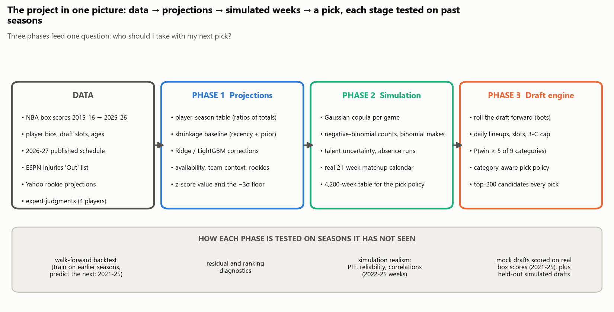

*Figure 1. The three phases of the project and how each is tested on seasons it has not seen.*


Phase 1 projects each player's per-game statistics for 2026-27. Phase 2 turns those averages into thousands of simulated fantasy weeks played on the real schedule. Phase 3 plays out the draft and the season for each candidate pick and recommends the player who maximises the probability of winning a weekly matchup. Every phase is evaluated against seasons it was not fitted on (the **walk-forward backtest**, the **realism check** of the simulated weeks, and **mock drafts scored on real box scores**); sections 4, 9 and 10 explain exactly how, because the credibility of the whole project rests on those tests.

*Roadmap.* Section 2 describes the data and its sources. Sections 3-8 cover Phase 1 (baseline, learned models and their testing, availability, team context, rookies and expert judgment, and the conversion to a ranking, including the long "Giannis" episode). Section 9 covers the simulation and its validation, section 10 the draft engine and pick policy, section 11 compares the final ranking with the market, section 12 lists last season's biggest jumpers and fallers, section 13 concludes, and section 14 sets out next steps (role and usage, returning from injury, roster change, positional depth).

# 2. Data and sources

## 2.1 Where the data come from

| Source | What was taken | Use in the project |
|---|---|---|
| NBA statistics API (`nba_api`, endpoint `LeagueGameLog`) | every player's box score in every regular-season game, 2015-16 to 2025-26 | the raw facts behind every projection |
| `nba_api` `PlayerIndex` | position label, draft slot and year, rookie year, current team (including the incoming rookie class) | priors for rookies, current teams, position groups |
| `nba_api` `LeagueDashPlayerBioStats` | age by season | aging effects |
| `nba_api` `ScheduleLeagueV2` | the published 2026-27 schedule (1200 games, 2026-10-20 to 2027-04-11) | the simulation plays every player on the days his team plays |
| ESPN injury report (espn.com/nba/injuries), "Out" designations, read on 14 Oct 2026 | players ruled out at the start of the season and the expected duration | the *known absences* input (section 5.3) |
| Yahoo draft-class projections (workbook supplied by the user) | per-game projections for 15 rookies | replaces the draft-slot profile for those rookies (section 7) |
| Hashtag Basketball ADP workbook (blended Yahoo, ESPN and Fantrax average draft position, 14 Oct 2026) | the market's draft order | **comparison only**; never an input to any model (section 11) |
| Expert judgment (the project owner) | four per-player inputs (Ingram, Porziņģis, Giannis, Haliburton) | documented overrides (section 7.2) |

Only regular-season games count (game ids beginning `002`). The NBA Cup final carries a different id family and is not part of the fantasy season; the Cup quarter- and semi-finals are regular-season games and are included. Exact ESPN position eligibility was not available (ESPN blocks the development machine), so positions are *approximated* from the API's position labels and each player's statistics; this affects only lineup-slot assignment, not projections.

## 2.2 What the database contains

| season | games | player-games | players |
|---|---|---|---|
| 2015-16 | 1,230 | 26,078 | 476 |
| 2016-17 | 1,230 | 26,139 | 486 |
| 2017-18 | 1,230 | 26,107 | 540 |
| 2018-19 | 1,230 | 26,101 | 530 |
| 2019-20 | 1,059 | 22,393 | 529 |
| 2020-21 | 1,080 | 23,054 | 540 |
| 2021-22 | 1,230 | 26,039 | 605 |
| 2022-23 | 1,230 | 25,895 | 539 |
| 2023-24 | 1,230 | 26,401 | 572 |
| 2024-25 | 1,230 | 26,306 | 569 |
| 2025-26 | 1,230 | 26,651 | 582 |

In total there are **281,164 player-games from 13,209 games**. The 2019-20 and 2020-21 seasons are shorter (about 71 and 72 games per team: the pandemic bubble and a compressed schedule) and the 2026-27 row is the schedule only. As an integrity check, the players' minutes in an NBA game must sum to 240 plus 25 per overtime for each team. 99.3% of the 26,418 team-games pass this test (within 3 minutes), so essentially every player who took the floor is in the data.

**Design rules that keep the numbers honest.** Points are a *generated column* (`2·FGM + 3PM + FTM`), so a points total can never disagree with its shots. Percentages are never stored or averaged: FG% is always `ΣFGM ÷ ΣFGA` over whatever window is asked about, which matters because a player who goes 1-for-1 one night and 1-for-20 the next shot 2-for-21 (9.5%), not 52.5%. This "totals first, divide last" rule is the basis of the next section.

# 3. Phase 1, step 1: the player-season table and a shrinkage baseline

## 3.1 Everything is a ratio of two totals

Almost every quantity we model is "something per something": rebounds per 36 minutes, makes per attempt, minutes per game, games played per team game. For each player-season we store the two totals and form the ratio only at the end:

| What we model | numerator ÷ denominator | scale |
|---|---|---|
| 2-pt attempts /36 | fga2 ÷ min | ×36 |
| 3-pt attempts /36 | fga3 ÷ min | ×36 |
| FT attempts /36 | fta ÷ min | ×36 |
| Rebounds /36 | reb ÷ min | ×36 |
| Assists /36 | ast ÷ min | ×36 |
| Steals /36 | stl ÷ min | ×36 |
| Blocks /36 | blk ÷ min | ×36 |
| Turnovers /36 | tov ÷ min | ×36 |
| 2-pt % | fgm2 ÷ fga2 |  |
| 3-pt % | tpm ÷ fga3 |  |
| FT % | ftm ÷ fta |  |
| Minutes per game | min ÷ gp |  |
| Availability (GP / team games) | gp ÷ sgo |  |

Points, FG% and FGM are not modelled separately; they follow arithmetically from the shot-level quantities: `FGM = 2P% × 2PA + 3P% × 3PA` and `PTS = 2·FGM + 3PM + FTM`. Modelling the *components* (attempts and make rates) is statistically preferable to modelling points directly, because the components have different noise levels: shot volume is a stable, role-driven quantity, whereas make rates are mostly luck at season scale.

## 3.2 Shrinkage: how much to trust a small sample

A player who went 12-for-20 from three last year is probably not a 60% shooter. The cure is to blend his own record with what comparable players do, in proportion to how much evidence there is. This is an **empirical-Bayes (shrinkage) estimator**, in the spirit of Efron and Morris's classic baseball-batting-average example:

> estimate = ( Σₗ wₗ · makesₗ + k · league_rate ) ÷ ( Σₗ wₗ · attemptsₗ + k ),   wₗ = decay^(l−1),  l = 1, 2, 3 seasons back

Here `league_rate` is the average rate for the player's position group (the *prior*), `k` is the number of "pseudo-attempts" of league-average play added to his record (a large `k` means a strong prior), and `decay` down-weights older seasons. Neither is guessed: for each stat they are chosen by grid search to minimise next-season weighted squared error **on training seasons only**. The fitted values (using all seasons up to 2025-26) are:

| stat | recency decay | prior strength k |
|---|---|---|
| 2-pt attempts /36 | 0.40 | 100 |
| 3-pt attempts /36 | 0.40 | 100 |
| FT attempts /36 | 0.40 | 250 |
| Rebounds /36 | 0.40 | 100 |
| Assists /36 | 0.40 | 100 |
| Steals /36 | 0.60 | 500 |
| Blocks /36 | 0.60 | 250 |
| Turnovers /36 | 0.40 | 250 |
| 2-pt % | 0.40 | 200 |
| 3-pt % | 1.00 | 400 |
| FT % | 0.60 | 50 |
| Minutes per game | 0.40 | 10 |
| Availability (GP / team games) | 0.40 | 40 |

Reading the table: stats that are mostly luck (3-point and free-throw percentage) get a large `k`, so the estimate leans on the league prior; stable, role-driven quantities (minutes, shot attempts) get small `k` and fast decay, so they follow recent seasons closely. For minutes and availability the "exposure" is games, so `k` is on a games scale.


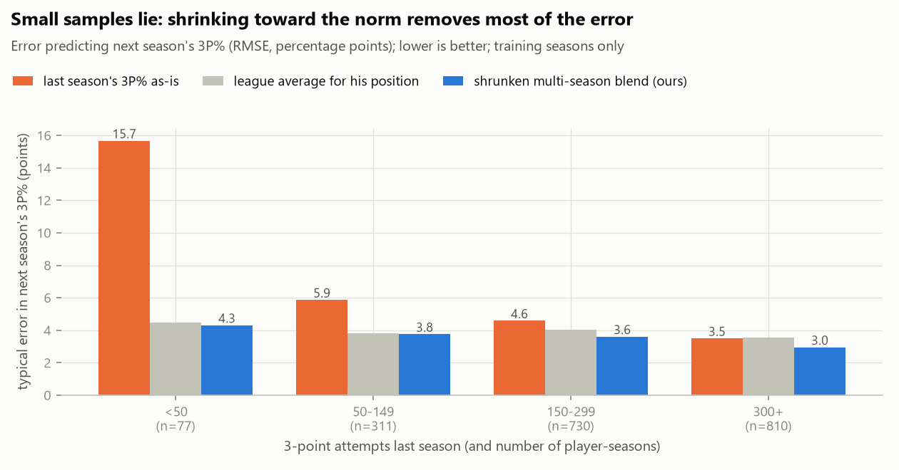

*Figure 2. Error predicting next season's 3P% by last season's attempts. Shrinkage helps most for the smallest samples and converges with the raw rate for high-volume shooters.*


For a player who attempted fewer than 50 threes, using his raw percentage is off by 15.7 points on average; the shrunken blend is off by 4.3 points, a **72% reduction**. For 300+ attempts the methods agree because there is enough evidence to trust the player.

**Worked example: Dyson Daniels** (the 2026-27 shooter, among those with 100-300 attempts, where shrinkage changes the estimate most):

| season | 3PA | 3PM | raw 3P% | weight |
|---|---|---|---|---|
| 2025-26 | 117 | 22 | 0.188 | 1.00 |
| 2024-25 | 235 | 80 | 0.340 | 1.00 |
| 2023-24 | 135 | 42 | 0.311 | 1.00 |

With a position-group prior of **0.363** and `k = 400`: numerator = 144.0 + 400·0.363 = 289.2, denominator = 487.0 + 400 = 887.0, so the shrunken estimate is **0.326**, compared with 0.188 from his last season alone. The final 2026-27 projection after the learned correction of section 4 is 0.314.

# 4. Phase 1, step 2: learned corrections and how they were tested

## 4.1 Three predictors per statistic

The shrinkage baseline uses only a player's own history. To use *other* information (age, experience, draft slot, position group, minutes and availability in each of the last three seasons, and the blends of all other stats) the baseline is supplemented by learned models of its **residual**, `y − baseline`. Fitting the residual rather than the raw statistic keeps the models stable: with no signal, they predict "no correction". For each statistic three candidates compete:

1. **Baseline**: the shrunken, recency-weighted average of section 3.
2. **Ridge regression**: a linear model of the residual with an L2 penalty, `argmin Σ wᵢ (rᵢ − xᵢᵀβ)² + α‖β‖²`, with features standardised and `α` chosen by cross-validation over a logarithmic grid (1 to 10,000). Ridge is appropriate when features are many and correlated (the blends of nine stats are highly collinear) and the signal per feature is small.
3. **LightGBM** (gradient-boosted regression trees): an additive ensemble of 250 small trees (6 leaves, learning rate 0.03, row and column subsampling 0.8, L2 penalty 5, at least 40 samples per leaf). Trees can learn non-linear shapes such as the bend of the aging curve and interactions such as age × role. Percentages use only baseline and Ridge, because shot-efficiency changes are close to linear in age and sample size and flexible models mostly fit noise there.

All models are weighted by exposure (minutes for rates, attempts for percentages, games for minutes and availability), so a 2,500-minute season counts more than a 600-minute one.

## 4.2 How the models were tested on previous years

A model's training error says almost nothing about how it will do next season, so the central question is: *how well does each method predict a season it has never seen?* Two design choices answer it.

**(a) A time-ordered (walk-forward) split, not a random split.** Randomly assigning player-seasons to training and test sets would let the model train on a player's 2024 season while predicting his 2023, using the future to predict the past, and it would also put the same player in both sets. Instead we use a **rolling-origin backtest** (a form of time-series cross-validation). For each target season `T` in 2021-22 ... 2025-26 we train on every season *before* `T` and predict `T`:


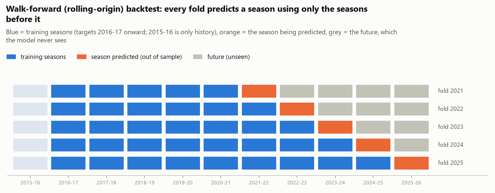

*Figure 3. Structure of the walk-forward backtest. Each fold trains only on seasons before the one it predicts; the final fold (2025-26) trains on nine seasons of targets.*


Fold sizes (players with at least 500 minutes in the predicted season): 2021-22: 333, 2022-23: 337, 2023-24: 326, 2024-25: 335, 2025-26: 337, a total of 1,668 out-of-sample player-seasons. Even the baseline's `decay` and `k` are re-fitted inside each fold from that fold's training seasons only, so there is no leakage of any kind.

**(b) A single pooled error criterion and a pre-declared selection rule.** For every statistic and fold we compute the exposure-weighted squared error `Σ wᵢ (yᵢ − ŷᵢ)² / Σ wᵢ` over players with ≥500 minutes in the target season (availability is judged separately, on established players, section 5), pool the five folds, and select the candidate with the lowest pooled error. Pooling five seasons guards against a method that wins one year by luck. The winner for each statistic and its gain over the baseline:


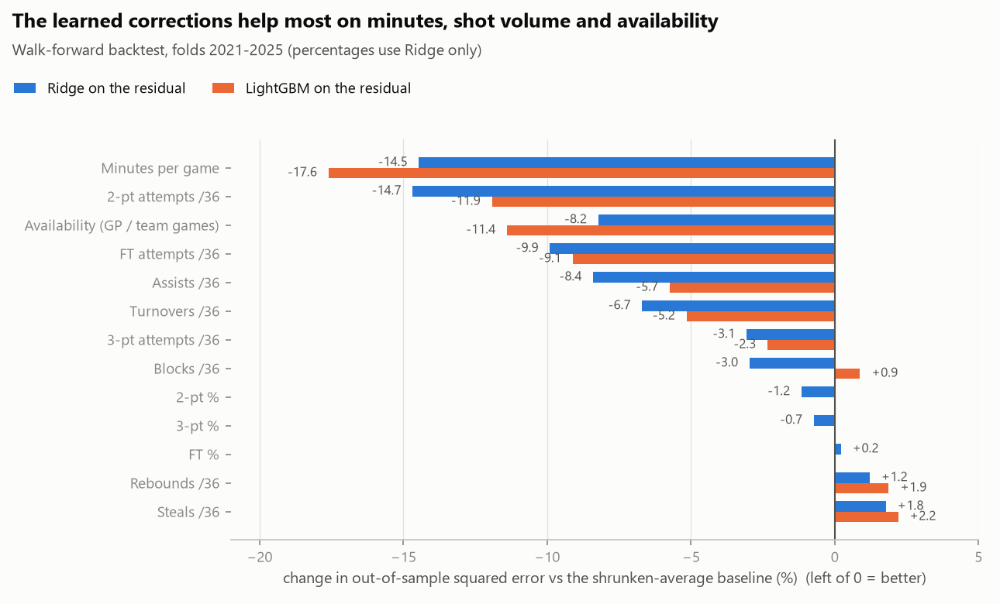

*Figure 4. Out-of-sample change in squared error relative to the shrunken baseline, by statistic and method. Bars to the left of zero are improvements.*


| stat | winning model | baseline RMSE | winning RMSE | change in squared error |
|---|---|---|---|---|
| Assists /36 | ridge | 0.894 | 0.856 | -8.4% |
| Availability (GP / team games) | lgbm | 0.217 | 0.204 | -11.4% |
| Blocks /36 | ridge | 0.257 | 0.254 | -3.0% |
| 2-pt attempts /36 | ridge | 1.596 | 1.475 | -14.7% |
| 3-pt attempts /36 | ridge | 1.162 | 1.144 | -3.1% |
| FT % | baseline | 0.050 | 0.050 | +0.0% |
| FT attempts /36 | ridge | 0.990 | 0.940 | -9.9% |
| Minutes per game | lgbm | 4.647 | 4.218 | -17.6% |
| 2-pt % | ridge | 0.040 | 0.040 | -1.2% |
| 3-pt % | ridge | 0.037 | 0.037 | -0.7% |
| Rebounds /36 | baseline | 0.920 | 0.920 | +0.0% |
| Steals /36 | baseline | 0.261 | 0.261 | +0.0% |
| Turnovers /36 | ridge | 0.427 | 0.413 | -6.7% |

**What this says.**

* **Minutes (-18%), shot volume (2-point attempts -15%), availability (-11%) and free-throw attempts (-10%) improve most.** These are *role* variables: young players' minutes rise, veterans' fall, and a tree model can find that structure. LightGBM wins for minutes and availability, where non-linearities matter; Ridge wins for most of the rest.
* **Rebounds, steals and free-throw percentage stay with the baseline.** Their year-to-year signal is already captured by the shrunken average, and the extra model only adds noise. That is a finding rather than a failure: the simpler model is kept wherever it wins.
* **Percentages move least** because at season scale they are mostly luck (see the shrinkage figure).

## 4.3 What the projections look like in fantasy terms

After the rate models run, the rates are multiplied back into per-game statistics. As a sanity benchmark we compare with the "naive" forecaster who assumes next year equals last year, on the same player-seasons (MAE = average absolute miss in per-game units; R² = share of the spread between players that the projection explains):

| category | player-seasons | average value | MAE (ours) | MAE (same as last year) | MAE improvement | R² (ours) | R² (last year) |
|---|---|---|---|---|---|---|---|
| PTS | 1,644 | 11.86 | 2.167 | 2.491 | +13.0% | 0.82 | 0.76 |
| 3PM | 1,644 | 1.34 | 0.338 | 0.358 | +5.5% | 0.76 | 0.71 |
| REB | 1,644 | 4.46 | 0.737 | 0.853 | +13.7% | 0.83 | 0.76 |
| AST | 1,644 | 2.71 | 0.597 | 0.669 | +10.8% | 0.83 | 0.78 |
| STL | 1,644 | 0.80 | 0.174 | 0.206 | +15.7% | 0.59 | 0.42 |
| BLK | 1,644 | 0.49 | 0.134 | 0.159 | +16.0% | 0.79 | 0.70 |
| TO | 1,644 | 1.38 | 0.290 | 0.342 | +15.2% | 0.78 | 0.70 |
| FG% | 1,644 | 0.47 | 0.029 | 0.035 | +17.4% | 0.71 | 0.53 |
| FT% | 1,637 | 0.77 | 0.048 | 0.063 | +23.6% | 0.52 | 0.07 |

The projection beats "same as last year" in every category. The gain is largest where last season's number is mostly noise: free-throw percentage (R² rises from 0.07 to 0.52) and steals (0.42 to 0.59). Steals remain the hardest category to predict.


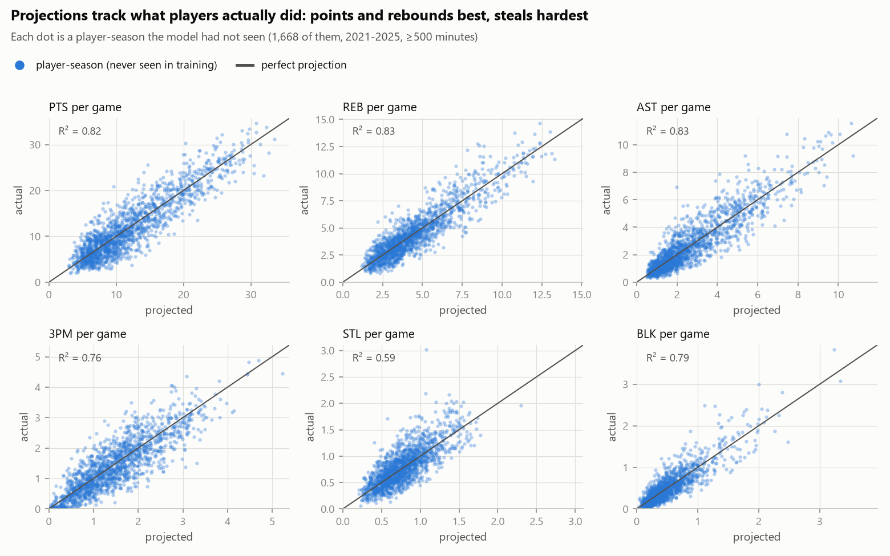

*Figure 5. Projected versus actual per-game values for out-of-sample player-seasons (2021-2025). The grey-orange diagonal is a perfect projection.*


## 4.4 The test that matters for a draft: ranking

A draft only needs to *order* players. For each backtest season we z-score the nine categories both for the projection and for what really happened (section 8 defines the z-score), then measure how well the projected ordering agrees with the actual ordering using **Spearman's rank correlation** ρ (the Pearson correlation of the two rank vectors). This is compared with ordering players by last season's actual production:


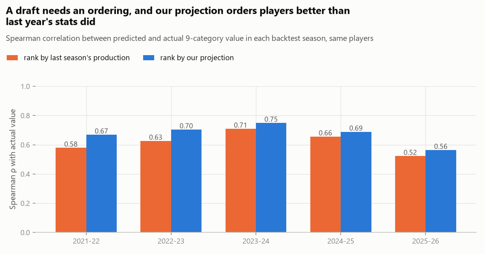

*Figure 6. Spearman rank correlation between predicted and actual 9-category value in each backtest season, for our projection and for last season's production.*


| season start | players | ρ (ours) | ρ (last year's stats) | top-50 hit rate (ours) | top-50 hit rate (last year) | k |
|---|---|---|---|---|---|---|
| 2021 | 329 | 0.669 | 0.579 | 66% | 56% | 50 |
| 2022 | 327 | 0.704 | 0.627 | 64% | 52% | 50 |
| 2023 | 322 | 0.750 | 0.709 | 64% | 66% | 50 |
| 2024 | 330 | 0.689 | 0.656 | 58% | 54% | 50 |
| 2025 | 336 | 0.564 | 0.523 | 50% | 48% | 50 |

The projection ranks better than last year's stats in **all 5 seasons** (average ρ = **0.675** against **0.619**), a modest but consistent edge. The edge in *picking out the top 50* is less uniform (it matched or beat last year's stats in 4 of 5 seasons), which is why the project does not oversell the projections: ranking is hard because injuries and breakouts decide a large share of the variance in any fantasy season. One caution on the 2025-26 fold (ρ = 0.56, the lowest): it contained an unusually large number of long injuries and the earliest versions of our availability model could not see them (section 5).

## 4.5 Residual diagnostics: where is the model wrong?

A **residual** is *actual − projected* for an out-of-sample player-season. Residual plots answer three questions that a single accuracy number cannot: is the model **biased** (consistently high or low in some region), is its **error size** steady across players (homoscedasticity), and are its **misses related to each other**?


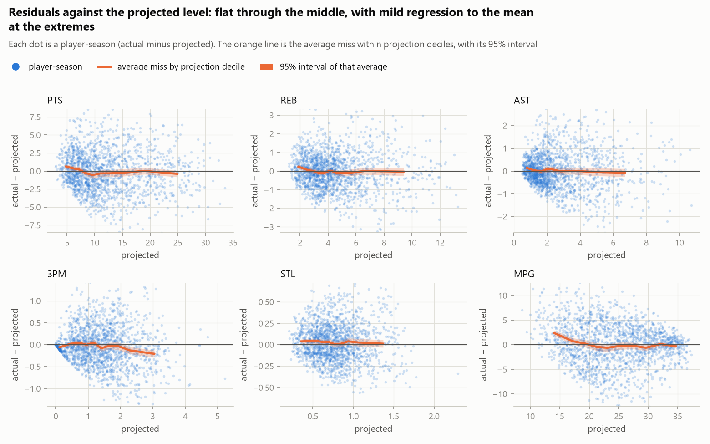

*Figure 7. Residuals versus projected level for six quantities. A trend line hugging zero means no bias at that level; a slope would mean the model mishandles stars or role players.*


Dots scatter evenly above and below zero and the decile averages stay close to the zero line through the middle of each panel, so stars are not systematically over-projected and role players are not systematically under-projected. Two mild departures are visible at the extremes. **Players projected for few minutes (below about 20 per game) were under-projected by one to two minutes on average**; this is partly a selection effect, because the evaluation only includes players who actually logged at least 500 minutes, and a player who earns those minutes tends to have been given more of a role than the projection expected. **Players projected for the most three-pointers are slightly over-projected** (the line slopes down to about −0.2 per game at the top), the usual regression to the mean for extreme shooting volume. Neither departure is large relative to the spread of the dots.

The spread of the misses also changes with the projected level (heteroscedasticity): the Spearman correlation between a player's projected level and the absolute size of his miss is reported in the table below (largest for BLK, ρ = +0.42). That is why the simulation of section 9 sizes talent uncertainty *relative* to a player's level for counting statistics rather than using one flat number.

| stat | n | bias (actual − projected) | ± SE | SD of miss | MAE | skew | share beyond 2 SD | ρ (error vs level) |
|---|---|---|---|---|---|---|---|---|
| PTS | 1,668 | -0.090 | 0.069 | 2.803 | 2.182 | +0.26 | 5.2% | +0.16 |
| 3PM | 1,668 | -0.042 | 0.011 | 0.448 | 0.340 | +0.23 | 5.8% | +0.33 |
| REB | 1,668 | -0.008 | 0.024 | 0.980 | 0.739 | +0.40 | 5.3% | +0.19 |
| AST | 1,668 | +0.021 | 0.020 | 0.826 | 0.601 | +0.60 | 5.7% | +0.37 |
| STL | 1,668 | +0.028 | 0.006 | 0.228 | 0.174 | +0.87 | 4.7% | +0.16 |
| BLK | 1,668 | -0.001 | 0.005 | 0.190 | 0.134 | +1.00 | 5.1% | +0.42 |
| TO | 1,668 | +0.012 | 0.010 | 0.389 | 0.291 | +0.50 | 5.9% | +0.25 |
| FG% (pts) | 1,668 | -0.088 | 0.095 | 3.861 | 2.919 | +0.26 | 5.9% | +0.10 |
| FT% (pts) | 1,668 | -0.470 | 0.162 | 6.607 | 4.807 | -0.79 | 5.2% | -0.19 |
| MPG | 1,668 | +0.098 | 0.104 | 4.264 | 3.290 | -0.13 | 5.5% | -0.25 |

* **Overall bias.** Categories whose average miss is more than 2.5 standard errors from zero: 3PM, STL, FT%. (Bias is in per-game units; FG% and FT% are in percentage points.)
* **Shape.** A normal distribution would have 4.6% of misses beyond two standard deviations; the table shows the observed shares for most categories, and the Q-Q plots below show that the *upper* tail of points and assists is heavier than Gaussian (breakout seasons and sudden role increases), while minutes are close to normal. The extremes are role changes and breakouts rather than smooth noise.


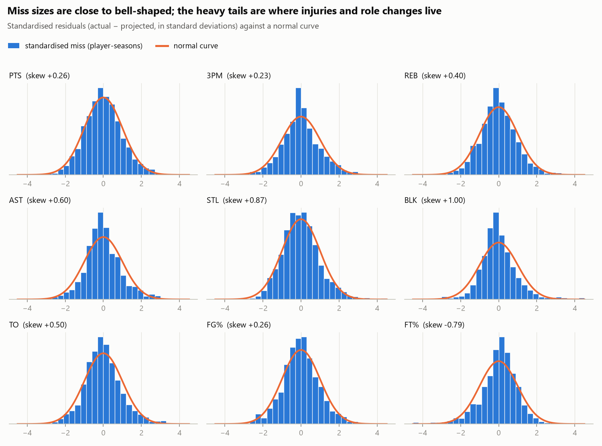

*Figure 8. Standardised residuals for the nine categories with a normal curve overlaid.*


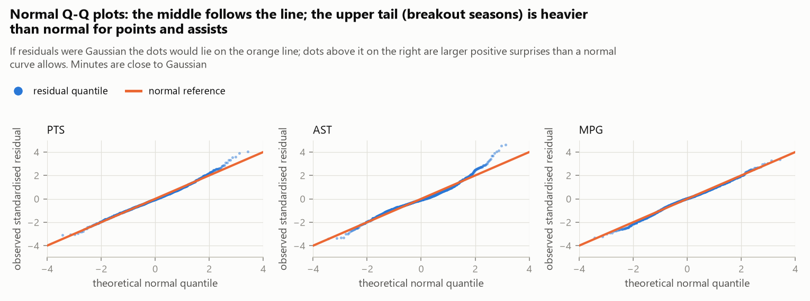

*Figure 9. Normal Q-Q plots for points, assists and minutes: close to the diagonal in the middle; the upper tail of points and assists is heavier than normal.*


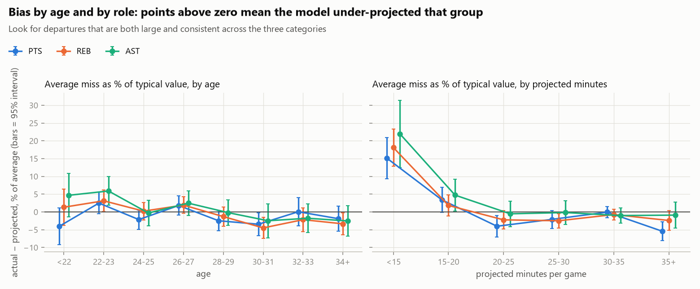

*Figure 10. Average miss by age and by projected minutes (95% intervals). Departures from zero that are large and consistent would be fixable biases, for example a too-gentle aging curve.*


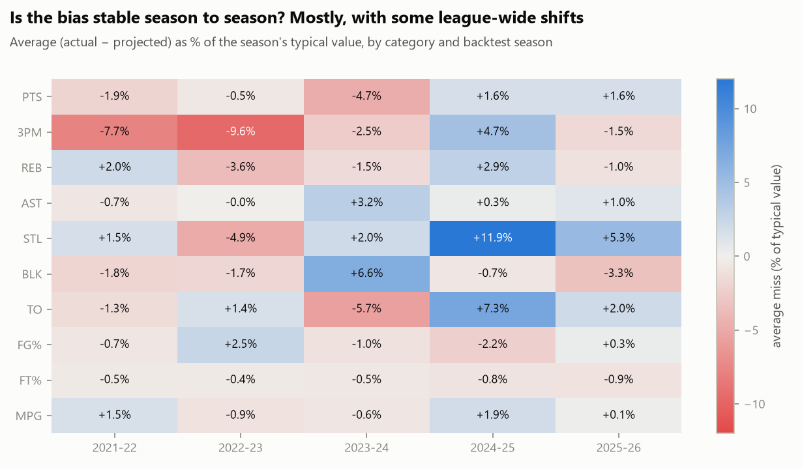

*Figure 11. Stability of the average miss across the five backtest seasons; the colour scale is symmetric around zero.*


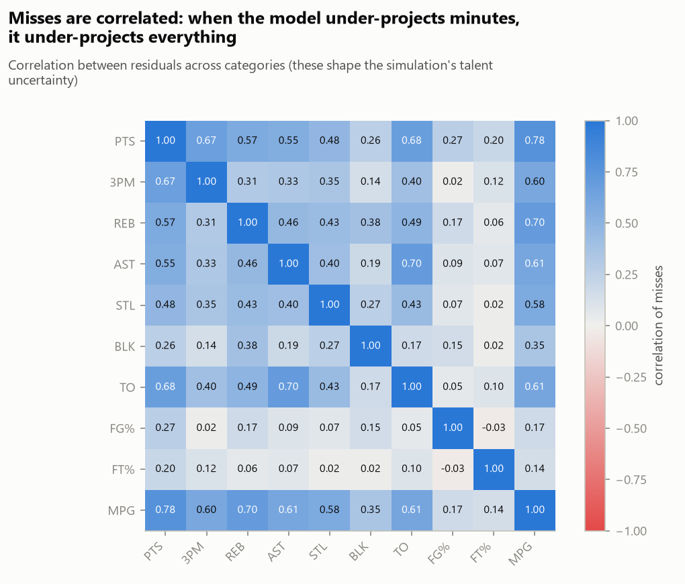

*Figure 12. Correlation between the misses of different categories. The strong block shows that most of what the model gets wrong about a player is shared across categories.*


**Misses move together.** The correlation between the points miss and the minutes miss is **0.78**: most of what the model gets wrong about a player is his *role* (minutes), which then spreads across every counting stat. This is the structure the simulation's "talent draw" reproduces (section 9): the projection's uncertainty is not nine independent errors but largely one shared error. It also explains why availability and minutes are the first places to look for improvements, which is what sections 5 and 6 do.


# 5. Phase 1, step 3: availability, the biggest source of error

## 5.1 The problem: games played is a different kind of variable

Counting statistics scale with games played, so a projection of 22 points per game is worth very different amounts to a fantasy team depending on whether the player appears in 80 games or 40. Availability turned out to be both the largest source of error and the place where the first version of the model was conceptually wrong. Three observations drove the redesign.

**(1) Games played are left-skewed, so the mean and the median disagree.** For rotation players (at least 25 minutes per game) over 2021-22 to 2025-26, the mean season was **62 games** but the median was **68**: 43% played 70 or more games, while a long tail of season-ending injuries (**18% played fewer than 50**) pulls the mean down.


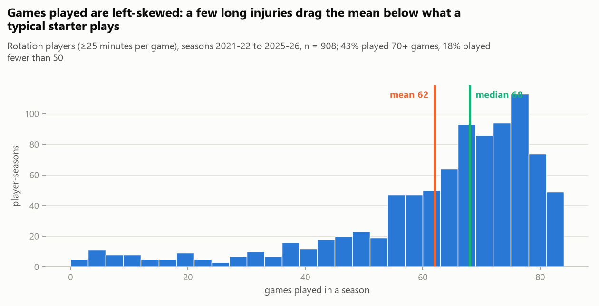

*Figure 13. Distribution of games played for rotation players, with the mean and median marked.*


Fantasy production is a *sum* over games, so the expected contribution of a player is governed by his **mean** games, and the ranking and the simulation use the mean. But "how many games should I expect a healthy player to play?" has a different answer, the **median**, which is what an owner intuitively means. We therefore also report a typical (median) games figure with a P25-P75 range, obtained by quantile regression of actual games on projected mean availability (display only; it never changes the ranking):

| projected mean availability | P25 games | median games | P75 games |
|---|---|---|---|
| 50% | 33.00 | 47.00 | 61.00 |
| 60% | 41.00 | 54.00 | 66.00 |
| 70% | 49.00 | 61.00 | 71.00 |
| 80% | 57.00 | 68.00 | 76.00 |
| 90% | 65.00 | 76.00 | 80.00 |

Reading the table: a player projected at 70% mean availability would typically play about 61 games, with a middle half-range of 49-71. (In development we also built a board ranked on the median instead of the mean; its ordering was almost identical, Spearman ρ = 0.996, so nothing was lost by keeping the mean.)

**(2) A player who is out at tip-off is not a random injury.** The first version defined the training target as *games played ÷ 82*. A player who misses the first two months with a known injury and then plays every game looks "50% available", exactly like a player who is hurt randomly all year. Yet the first is almost perfectly healthy once back and, more importantly, **was known to be out before the season started**. At the start of 2025-26 Lillard, Kyrie Irving, Haliburton and Tatum were all publicly known to be injured; the model, unaware, expected normal seasons from them and was then "wrong" in training, which also taught it that availability is lower than it really is. The fix has three parts:

* The target becomes **availability since the first appearance**, `avail = games played ÷ team games from his first game on` (`sgo`), and players who never played in a season are not training targets. This measures how often a player is available *when he is in the league that season*.
* **Known absences become an input**, not something to be predicted (section 5.3): the final availability is `avail × (82 − games_out) ÷ 82`.
* A player's first appearance is detected from the box scores (the first game with minutes), and `smiss` records how many team games came before it.


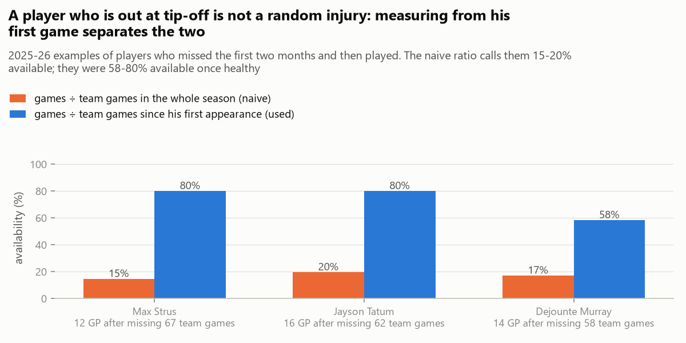

*Figure 14. Naive availability versus availability since the first appearance, for three players who missed their team's first two months in 2025-26.*


| player | games played | team games | team games since his first game | team games before it | naive availability | availability once playing |
|---|---|---|---|---|---|---|
| Max Strus | 12 | 82 | 15 | 67 | 15% | 80% |
| Jayson Tatum | 16 | 82 | 20 | 62 | 20% | 80% |
| Dejounte Murray | 14 | 82 | 24 | 58 | 17% | 58% |

**(3) A first diagnosis that turned out to be a selection artifact.** Early on a backtest seemed to show that the model under-projected games for *everyone* by two to three games. That was an artifact of the evaluation set (only players with at least 500 minutes can appear, which silently removes the injury-shortened seasons the model had correctly predicted). A selection-free evaluation, on all established players who appeared, showed that the real misses were confined to **returners** (players with no season the year before) and to players who changed teams, which is where sections 5.4 and 6 look.

## 5.2 How availability was tested

Availability is evaluated on *established* players (at least 500 minutes the previous season) who appeared in at least one game that season, in the same walk-forward folds as every other statistic. Errors are expressed in games per 82. Against a pure recency average, the model's typical miss is slightly smaller in four of the five groups and tied for ages 30-32, but the real difference is in the **bias**: the recency average over-projects games by about 7 for players who changed teams, 5 for players aged 33 and over and 4.5 for ages 30-32, while the model's bias is 2-3 games in those groups.


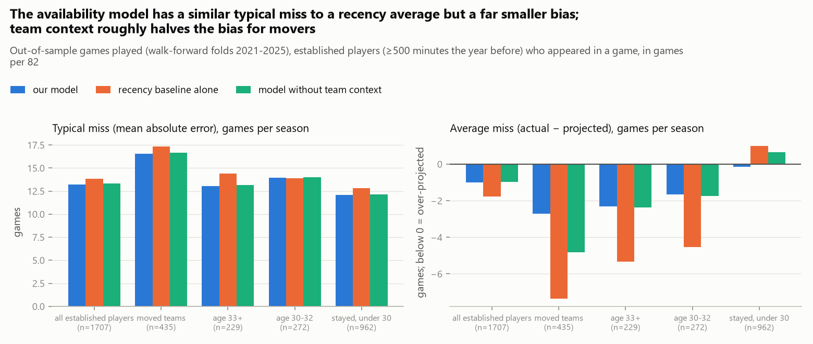

*Figure 15. Out-of-sample games-played error and bias by group: the model, the recency baseline alone, and the model without team-context features.*


| group | n | model MAE | model bias | baseline MAE | baseline bias | no-context MAE | no-context bias |
|---|---|---|---|---|---|---|---|
| all established players | 1,707 | 13.2 | -1.0 | 13.9 | -1.8 | 13.3 | -1.0 |
| moved teams | 435 | 16.5 | -2.7 | 17.3 | -7.4 | 16.7 | -4.8 |
| age 33+ | 229 | 13.0 | -2.3 | 14.4 | -5.3 | 13.1 | -2.4 |
| age 30-32 | 272 | 13.9 | -1.7 | 13.9 | -4.5 | 14.0 | -1.7 |
| stayed, under 30 | 962 | 12.1 | -0.1 | 12.8 | +1.0 | 12.2 | +0.7 |

The typical miss is about 13 games for the whole group, which is large; that is the irreducible randomness of injuries, and it is why the simulation of section 9 treats availability as a random variable rather than a constant. The model's bias is small and **negative** (it over-projects games by about 1.0 on average and by 2.7 for players who moved teams); without the team-context features the bias for movers grows to 4.8 games.

## 5.3 Known absences: using information the model cannot learn

Some information is simply not in the box scores: the ESPN injury report lists who is ruled out and for how long. We read the "Out" designations on 14 October 2026 and convert each expected return date into games missed (using each team's real schedule). Two entries are hand-set by the project owner and take precedence over ESPN (section 7.2). The result is 21 ESPN entries plus 2 manual ones:

| player | team | games out | source |
|---|---|---|---|
| Henri Veesaar | Atlanta Hawks | 82 | ESPN 'Out' list |
| Ariel Hukporti | Philadelphia 76ers | 82 | ESPN 'Out' list |
| Kristaps Porziņģis |  | 82 | manual (owner) |
| Jamir Watkins | Washington Wizards | 76 | ESPN 'Out' list |
| Donte DiVincenzo | Minnesota Timberwolves | 76 | ESPN 'Out' list |
| Brandon Ingram |  | 60 | manual (owner) |
| Shaedon Sharpe | Portland Trail Blazers | 60 | ESPN 'Out' list |
| Jordan Miller | LA Clippers | 59 | ESPN 'Out' list |
| Mark Williams | Phoenix Suns | 48 | ESPN 'Out' list |
| Johnny Furphy | Indiana Pacers | 33 | ESPN 'Out' list |
| Jimmy Butler III | Golden State Warriors | 33 | ESPN 'Out' list |
| Jayden Quaintance | San Antonio Spurs | 23 | ESPN 'Out' list |
| Moses Moody | Golden State Warriors | 20 | ESPN 'Out' list |
| Jusuf Nurkić | Utah Jazz | 7 | ESPN 'Out' list |
| Max Strus | LA Clippers | 6 | ESPN 'Out' list |
| Tristan Vukcevic | Washington Wizards | 6 | ESPN 'Out' list |
| Yanic Konan Niederhäuser | LA Clippers | 5 | ESPN 'Out' list |
| Brandon Ingram | LA Clippers | 5 | ESPN 'Out' list |
| Izaiyah Nelson | Orlando Magic | 5 | ESPN 'Out' list |
| Dylan Cardwell | Sacramento Kings | 4 | ESPN 'Out' list |
| Keshad Johnson | Miami Heat | 3 | ESPN 'Out' list |
| Maxime Raynaud | Sacramento Kings | 2 | ESPN 'Out' list |
| Isaiah Stewart | Memphis Grizzlies | 1 | ESPN 'Out' list |

"Day-to-day" listings (mostly pre-season rest) are ignored by design. A player with `games_out` games to miss has his availability scaled by `(82 − games_out) ÷ 82` on top of whatever the model gives him for the rest of the season, which is why Porziņģis (82 games out) is ranked last among the 614 projected players and Ingram (60 out, board rank 540) near the bottom.

## 5.4 Returners: a missed season is information

A *returner* is a player with no season in the previous year but earlier history (Kyrie Irving and Tyrese Haliburton in 2026-27). Two choices follow from the data.

**Availability for returners is a 50/50 blend of the model and the recency baseline.** On the 94 returner-seasons in which the player appeared in a game, the shipped blend has a mean absolute error of 20.5 games against 22.5 for the baseline, and its bias is -4.0 games (baseline -11.4); for former rotation stars the bias is +3.2 games (n = 15).

**Minutes for returners fall, and the model's cut is about the right size.** Among 24 returners who then played at least 500 minutes, the average last-known minutes were 25.1 and the return minutes 21.5. For the 12 former rotation stars (28+ minutes before) the drop was larger: **33.1 → 26.5**.


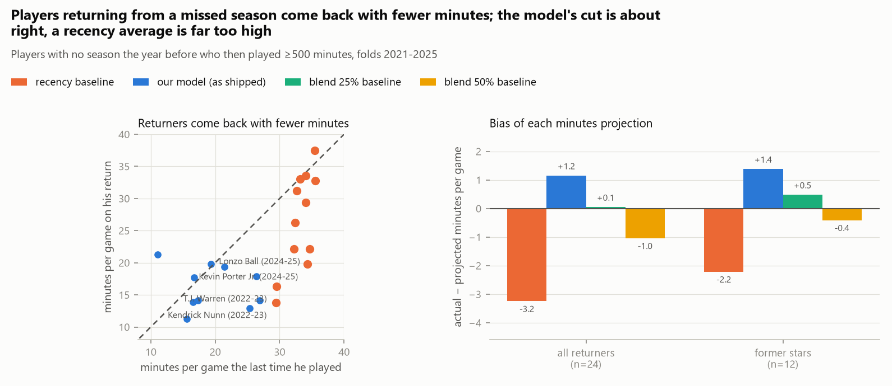

*Figure 16. Left: minutes before and after a missed season for returners (dashed line: no change). Right: the average error of each minutes projection for all returners and for former stars.*


A recency average would over-project minutes by 3.2 for all returners and 2.2 for former stars; the shipped model is within 1.2 and 1.4 minutes of the truth, and blending the minutes back toward the baseline *increases* the error, so no such blend is used for minutes. The model is, if anything, slightly *low* (+1.4 minutes for stars, a 1.4-minute under-projection in a sample of 12), a point revisited in section 7.2 for Haliburton.

**Why does the model cut so much?** For Haliburton it projects 26.3 minutes against a recency baseline of 31.1. The cut does not come from his age, a "returner flag" or his team context: when we filled in his missing 2025-26 season with a copy of his 2024-25 season the model returned 33.4 minutes. The reduction comes entirely from the *blank* last-season slot, which the models have learned from past players (in the training seasons, 16 former rotation stars who missed a year went from about 33.0 to 27.1 minutes) to treat as a sign of a smaller role on return.

## 5.5 What we did not change

Because the first suspicion was that team-context features might be corrupting the games-played model (Powell's and Murray's projected games dropped by five to six when context was added), we ran an explicit ablation. Removing the context features from the *availability* model made it worse (squared error +1.3%) and raised the bias for movers, so the features were kept (section 6). Likewise, season-of-career indicators (second- to fourth-year players) reduced the under-projection of third-season players only slightly and did not improve overall accuracy:


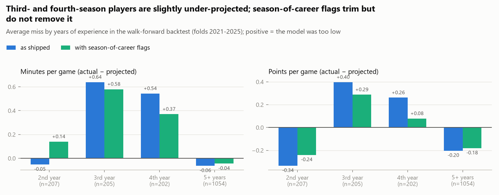

*Figure 17. Average miss in minutes and points by years of experience, for the shipped model and a variant with season-of-career flags.*


| variant | group | n | mpg | ppg |
|---|---|---|---|---|
| shipped | 2nd year | 207 | -0.05 | -0.34 |
| shipped | 3rd year | 205 | +0.64 | +0.40 |
| shipped | 4th year | 202 | +0.54 | +0.26 |
| shipped | 5+ years | 1054 | -0.06 | -0.20 |
| with season-of-career flags | 2nd year | 207 | +0.14 | -0.24 |
| with season-of-career flags | 3rd year | 205 | +0.58 | +0.29 |
| with season-of-career flags | 4th year | 202 | +0.37 | +0.08 |
| with season-of-career flags | 5+ years | 1054 | -0.04 | -0.18 |

The third-year bias (+0.6 minutes, +0.4 points per game for the shipped model) is real but small relative to the typical miss of two points, and even a full correction would move a player such as Stephon Castle only about nine places on the board, so the simpler model was kept.

# 6. Phase 1, step 4: team context

## 6.1 Roster moves change opportunity

A player's stat line depends on who else is on the floor. When a team loses 150 minutes of rotation play to departures, the minutes and possessions are redistributed; when it adds a star, they shrink. For each player-season we therefore compute, from the player-level box scores:

* **vacated minutes and possessions**: the minutes and possessions used last season by players who are no longer on the team;
* **incoming minutes and possessions**: those brought by players who joined;
* the same quantities **within the player's position group** (guards, forwards or centers), because a guard's role depends more on departing guards;
* a **moved** indicator, and interactions with the player's own usage (a star absorbs vacated shots; a role player does not).

His own contribution is removed so that a player does not "vacate" himself. For past seasons the "opening roster" is the set of players who appeared in the team's first ten games; for 2026-27 it is each team's current roster minus known absentees (a player who will miss many games opens minutes for others). These features simply join the other inputs of the Ridge and LightGBM corrections of section 4; the baseline itself is unchanged.

## 6.2 Evidence from the walk-forward backtest

Held fixed everything else and dropped the context columns for every statistic (the "no context" model of section 4's folds):


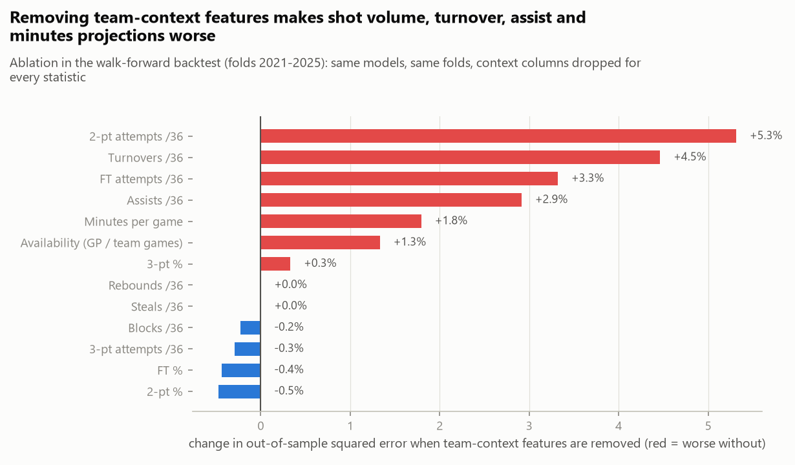

*Figure 18. Out-of-sample error change when team-context features are removed, by statistic.*


On average the squared error is **+1.4%** higher without context, with the largest losses for 2-point attempts, turnovers, free-throw attempts and assists, exactly the quantities that depend on usage and role. In the original development test (movers and stayers separated, which the pooled folds cannot do), context reduced the points error for players who changed teams by about 7%, with similar gains for attempts and turnovers, and left stayers essentially unchanged; we report that earlier result as a design check, not a rerun.

**One caution that led to a player-specific decision (section 8.3).** For the 20 star movers in that test the context features reduced the *points* error by 13% but increased the *minutes* error by 11% (the model under-projected their minutes by about 0.8 per game). The context adjustment is therefore directionally right but can be heavy for a star changing teams, which is exactly what happened to Giannis Antetokounmpo (Milwaukee to Miami).

# 7. Rookies and expert inputs

## 7.1 Rookies: a prior from the draft slot

A rookie has no box scores, so the only prior is his draft slot. All first-season players since 2015-16 are grouped into five buckets (picks 1-5, 6-14, 15-30, 31-60, undrafted) and each bucket's average rates are used as the projection, with each bucket's coefficient of variation stored for the simulation's uncertainty.


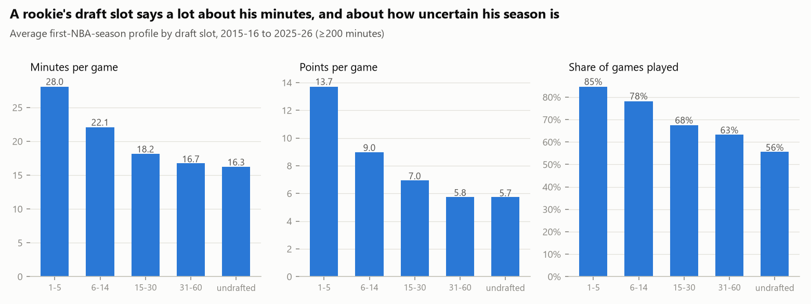

*Figure 19. Average first-season minutes, points and games played by draft-slot bucket.*


**Why buckets and not a smooth curve?** We compared the bucket means with a regression on log(draft pick) by leaving out each rookie class in turn and predicting it from the others (mean absolute error per game):

| method | MPG | PTS | REB | AST | STL | BLK |
|---|---|---|---|---|---|---|
| draft-slot bucket means (used) | 4.814 | 2.499 | 1.233 | 0.880 | 0.225 | 0.246 |
| smooth curve in log(pick) | 4.875 | 2.528 | 1.236 | 0.882 | 0.227 | 0.245 |

The smooth curve is no more accurate (the differences are in the third decimal place), so the simpler buckets are used. The consequence is that every rookie in a bucket gets the same projection, so individual standouts cannot be anticipated from draft slot alone. For the 2026 class, 15 rookies have an outside projection from Yahoo, which **replaces** the draft-slot profile for points, rebounds, assists, steals, blocks, field-goal and three-point percentage and (where given) minutes, with shot volume solved so that the projected points and percentages are reproduced exactly; free-throw percentage, turnovers and availability keep the draft-slot profile:

| pick | name | team | PPG | RPG | APG | MPG (blank = model's) |
|---|---|---|---|---|---|---|
| 1 | AJ Dybantsa | Washington Wizards | 19.2 | 6.1 | 3.3 | 32 |
| 2 | Darryn Peterson | Utah Jazz | 18.4 | 4.2 | 3.1 |  |
| 3 | Cameron Boozer | Memphis Grizzlies | 17.6 | 8.7 | 3.6 | 31 |
| 4 | Caleb Wilson | Chicago Bulls | 15.3 | 7.2 | 2.3 | 28 |
| 5 | Keaton Wagler | Los Angeles Clippers | 12.6 | 3.7 | 3.4 | 24 |
| 6 | Mikel Brown Jr. | Brooklyn Nets | 13.8 | 3.0 | 4.8 | 26 |
| 7 | Darius Acuff Jr. | Sacramento Kings | 17.2 | 2.9 | 5.6 | 30 |
| 8 | Kingston Flemings | Atlanta Hawks | 7.4 | 2.8 | 3.7 | 20 |
| 9 | Morez Johnson Jr. | Dallas Mavericks | 7.2 | 5.0 | 1.1 | 18 |
| 10 | Brayden Burries | Milwaukee Bucks | 12.4 | 4.1 | 2.8 | 25 |
| 11 | Yaxel Lendeborg | Golden State Warriors | 11.8 | 6.2 | 3.1 | 25 |
| 12 | Aday Mara | Oklahoma City Thunder | 6.4 | 4.5 | 1.3 | 14 |
| 13 | Nate Ament | Milwaukee Bucks | 9.6 | 4.8 | 1.8 | 22 |
| 14 | Hannes Steinbach | Charlotte Hornets | 5.6 | 6.3 | 1.2 | 19 |
| 24 | Cameron Carr | Los Angeles Lakers | 7.8 | 2.6 | 1.3 | 17 |

## 7.2 Four documented judgments

A few players are cases where information outside the data matters more than anything the model can learn. Each is a recorded override or input, not a silent edit:

| Player | Input | Reason | Effect on the 2026-27 board |
|---|---|---|---|
| Brandon Ingram | 60 games out | partially torn Achilles; ESPN lists a short absence, the owner judged at least 3 months and likely much longer | board rank 540 |
| Kristaps Porziņģis | 82 games out (whole season) | owner instruction; listed day-to-day but away from the team | board rank 614 (last) |
| Giannis Antetokounmpo | 2025-26 season ignored; no team-context adjustment | his 36 games were rest while seeking a trade, not injury; the context penalty for the Miami move was heavy | board rank 6 (section 8.3) |
| Tyrese Haliburton | expected minutes 29.8 | model gave 26.3 after the missed season; owner judged it low | board rank 62 → 35 |

For a minutes override, the player's other per-game totals are rescaled at the same time (per-minute rates unchanged); otherwise the board and the simulation, which read per-game totals, would not change. All overrides live in `data/external/` and are reapplied by every rebuild.

# 8. Phase 1, step 5: from projections to a ranking

## 8.1 The nine-category value score

Each projected line is converted to nine **z-scores**, one per category, measured against a reference pool of the 156 highest-valued players (selected iteratively, four passes, so the benchmark is "a drafted player" rather than the league including end-of-bench filler). Counting statistics are multiplied by expected availability; percentages use the **impact** form: the quantity that is z-scored is `(FGM − pool FG% × FGA) × availability`, so a player's shooting percentage matters in proportion to his volume (a 60% shooter on 3 attempts matters far less than a 52% shooter on 15). Turnovers are sign-flipped. The **value** is the sum of the nine z-scores, with one modification, described next.


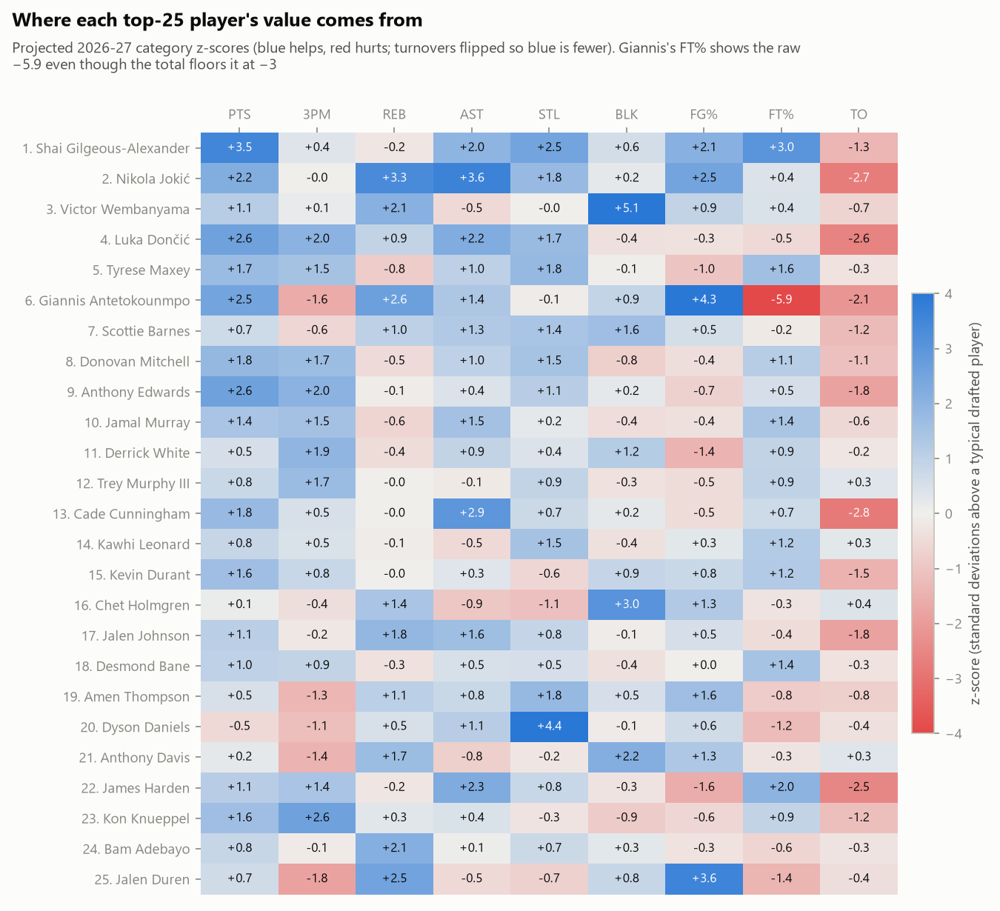

*Figure 20. The top 25 players of the 2026-27 board by category z-score. Rows show each player's archetype.*


*Reading the heat map.* Jokić is blue almost everywhere except turnovers; Wembanyama's value is concentrated in blocks, rebounds and points; a player with the same total but a different pattern of blue and red is a different kind of asset, which the draft engine of section 10 exploits.

## 8.2 The "z-floor": why a sum of z-scores is wrong at the extremes

In weekly head-to-head each category is **won or lost**, so being six standard deviations bad at one category costs the same *one* category as being three standard deviations bad, but a plain sum charges the six-sigma player twice as much. We therefore floor each category's contribution at −3 when forming the total (only the negative tail; strengths count in full). The raw z-scores are retained and `z_floor_adj` records what the floor added back. For 2026-27 the floor changes 11 of 614 projected players, but **only one inside the board's top 150: Giannis Antetokounmpo**, whose total rises by 2.9. The other ten are players projected to miss most or all of the season, whose total is already hopeless.

## 8.3 The Giannis dilemma

This episode is worth telling in full because it shows the process of reconsidering a model: a result that disagreed with every other projection and with the owner's judgment was *not* dismissed as the market being wrong, and *not* patched, but investigated until each piece had a specific, testable cause.

**The symptom.** Our board ranked Giannis Antetokounmpo 93rd (later 103rd), far below every public ranking and the owner's own instinct, who is a consensus top-10 player.

**Step 1: is it a bug? No, and the counterfactuals show why.** At that time his projection was 24.8 points, 29.0 minutes and 65% availability at age 32, with a free-throw impact z-score of −4.7 and three-pointers at −1.7, against a field-goal-percentage z-score of +3.6, giving a total of −1.4. The per-36 rates were normal; the drag was **minutes and games, both anchored on his injury-shortened 2025-26 (36 games, 28.9 minutes)** through the 0.4 recency decay. Cumulative counterfactuals, run when he stood at 103rd, located the causes:


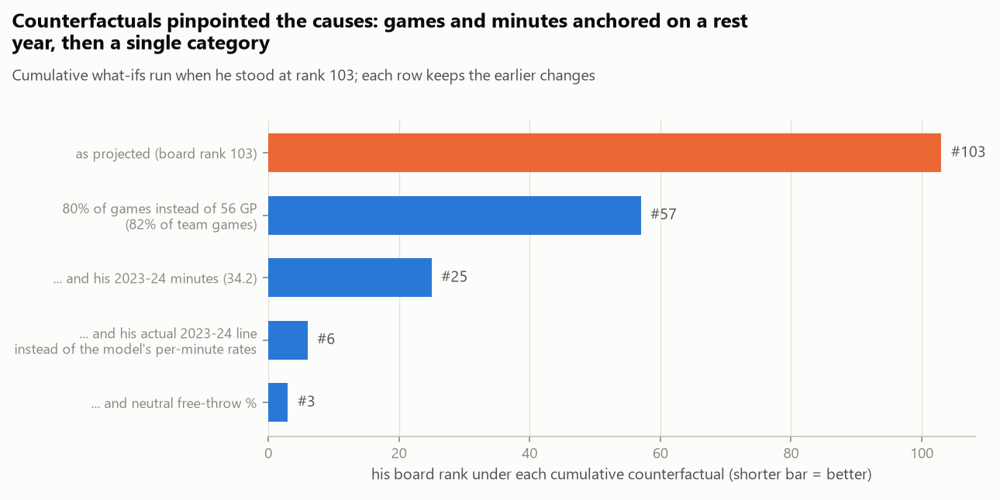

*Figure 21. Cumulative what-if ranks for Giannis: the lower the bar the better. Each bar keeps the earlier changes.*


* with 82% of games instead of 56, he moves to 57th;
* adding his 2023-24 minutes (34.2) moves him to 25th;
* replacing the model's per-minute rates by his actual 2023-24 line moves him to 6th;
* a neutral free-throw percentage alone moves him to 3rd; free throws by themselves were worth roughly 22 places at full role.

So two separate things were involved: a **data** problem (a depressed 2025-26 anchoring his minutes and games) and a **scoring-rule** problem (free throws). (At the very first look, with him at 93rd, the same exercise gave 66th if nobody were discounted for games, 84th with half the discount, and 11th if he were given his 2023-24 role of 34.2 minutes and 82% of games.)

**Step 2: the 2025-26 season was not an injury.** The owner pointed out that Giannis's 36 games were *rest* while he pushed for a trade, not a health problem. The model cannot know that. We added a mechanism to **drop a season from a player's history** (`ignore_seasons`): earlier seasons slide forward one lag and age is adjusted, as if 2025-26 had never happened. Result: his projection rose to 32.1 minutes, 26.6 points and 62 games, and his rank improved from **103rd to 59th**.

**Step 3: the team-context penalty was heavy.** The move to Miami cost him 1.7 points and 0.9 minutes through the context features (without them he would have ranked 33rd). We tested that choice directly on star movers (the check described in section 6.2): the context features reduced the points error by 13% but made the minutes error 11% worse, i.e. directionally right but too heavy for stars. At the owner's request his context adjustment was switched off (`no_team_context`): **59th to 29th**.

**Step 4: the rule itself was the last problem.** Even then he stood 29th, and "even with availability 100% for everyone he is only 79th per game". The cause is the free-throw category: his FT% impact is a six-sigma outlier (z of −5.2, −5.5 and −6.3 in his last three full seasons) while the standard deviation of free-throw impact across the pool is only about 0.3 makes per game. By a plain sum of z-scores, **our own method ranked his actual 2022-23, 2023-24 and 2024-25 seasons 133rd, 28th and 59th**, a result nobody believes:


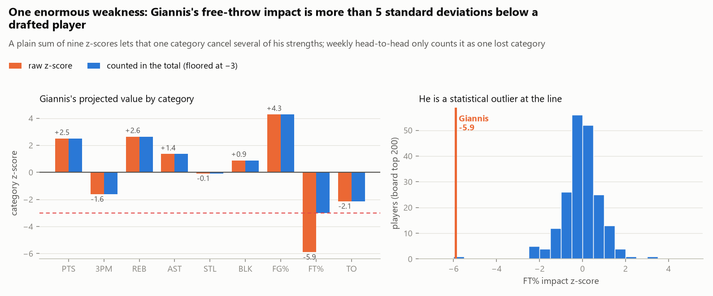

*Figure 22. Giannis's category z-scores for 2026-27 (raw and as counted in the total) and where his free-throw impact lies in the distribution of the top 200 players.*


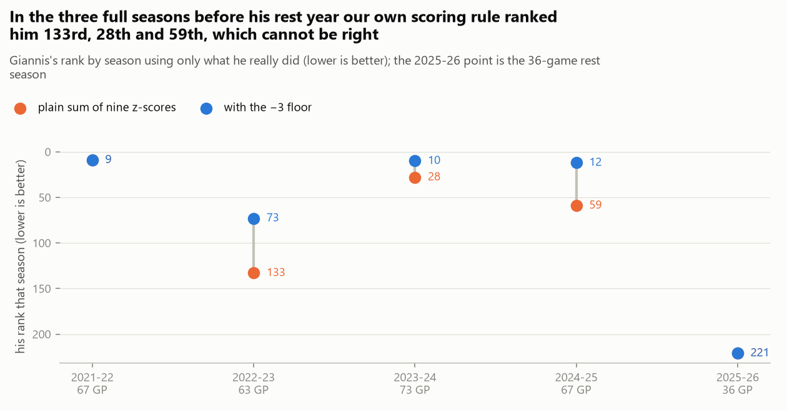

*Figure 23. Giannis's rank in each of the last five seasons, computed from what he actually did, with and without the −3 floor.*


| season | GP | rank, plain sum | rank, floored | FT% z-score | PPG | MPG |
|---|---|---|---|---|---|---|
| 2021-22 | 67 | 9 | 9 | -2.5 | 29.9 | 32.9 |
| 2022-23 | 63 | 133 | 73 | -5.2 | 31.1 | 32.2 |
| 2023-24 | 73 | 28 | 10 | -5.5 | 30.4 | 35.2 |
| 2024-25 | 67 | 59 | 12 | -6.3 | 30.4 | 34.2 |
| 2025-26 | 36 | 221 | 221 | -2.8 | 27.6 | 28.9 |

The floor (section 8.2) is the principled fix: it encodes what a weekly category format does with a lost category. With the floor, his actual seasons rank 73rd, 10th and 12th, and his 2026-27 projection moves from **29th to 6th**, which matches his market order of 6.

**Step 5: did we try to *exploit* his weakness (punting free throws)?** Since only 5 of 9 categories are needed, a team that gives up free throws can build around a player like Giannis. Our first test of that idea forced the later picks to ignore FT%. It made the team *worse*: a balanced roster that includes good free-throw shooters won more weeks, and extra punting (free throws plus three-pointers, assists and steals) was far worse. 


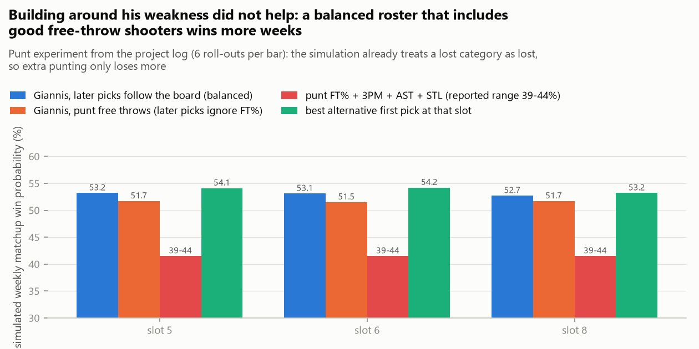

*Figure 24. Punt experiment: simulated weekly win probability with Giannis as the pick when the later picks follow the board, punt free throws, or punt four categories (bars labelled with the percentage; the four-category result was recorded as a 39-44% range).*


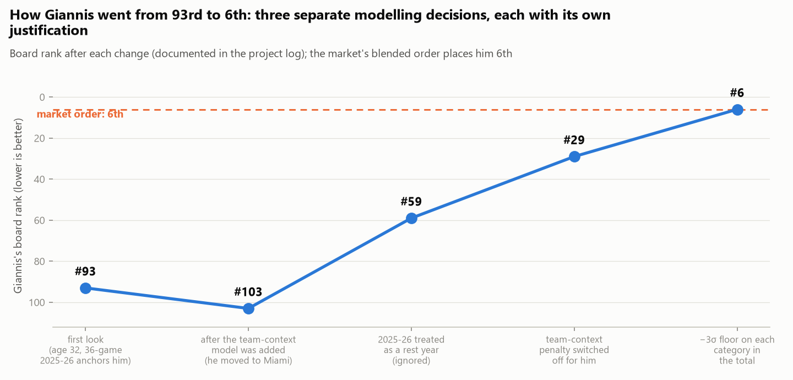

*Figure 25. Giannis's board rank after each modelling decision.*


**What the episode shows.** (i) A single ranking number can hide three different problems: a data anchor (rest year), a model choice (team context) and a scoring rule (sum of z-scores). (ii) Counterfactual analysis (change one input, re-rank) is a fast way to separate them. (iii) The adjustments were each tested against data or justified by how the league scores weeks, and the floor changes *no one else* in the top 150, so it did not buy Giannis a better rank at anyone's expense. (iv) What did **not** work (punting) was tested and reported, not assumed.


# 9. Phase 2: from an average to a distribution of weeks

## 9.1 Why simulate?

A league matchup is decided by *one week*, and a week is noisy. Two players with the same season average can have very different weekly spreads (a star who never misses versus one who misses 40% of weeks), and the *joint* behaviour of a roster's nine categories matters, because the objective is the probability of winning more than 4.5 of them. A table of season averages cannot answer "how often does this roster win five categories?", but a stochastic model of weeks can. The simulation turns every projected average into thousands of realistic simulated **matchup periods**, played on the real 2026-27 calendar.

## 9.2 The model, step by step, for one player in one period

1. **Pick a real matchup period** of the league calendar (21 of them, including the three playoff weeks); the player's team plays on its real days.
2. **Talent draw.** The projection is only a best guess, so perturb it: each statistic's per-game mean is multiplied by a lognormal factor `exp(σ·ε − σ²/2)` (mean one) and shooting percentages are shifted additively; the shocks `ε` are *correlated across statistics* (estimated from the backtest residuals, section 4.5) and `σ` depends on experience (and on draft-slot tier for rookies). This represents "how wrong could the projection be?".
3. **Availability.** With probability `c·(1 − avail)` the player misses the whole period (an injury run). Otherwise he plays each scheduled game with the probability that makes his expected games equal `avail × team games`. The constant `c` = **0.68** is the share of missed games that come in whole-period absences.
4. **For each game he plays, draw a stat line with a Gaussian copula.** Draw 11 correlated standard normals `Z ~ N(0, R)`, turn each into a uniform `U = Φ(Z)`, and push each through its own marginal inverse CDF: counts (2-point, 3-point and free-throw attempts, rebounds, assists, steals, blocks, turnovers) are **negative binomial** (variance exceeds the mean, because real counts are streaky), and makes are **binomial**(attempts, make rate), with the make rate's quantile driven by its own copula dimension (a Beta jitter adds streakiness where the data show it).
5. **Compute points and percentages from the shots**: `PTS = 2·FGM + 3PM + FTM`. They are never simulated directly.

*Why these distributions.* Counting statistics are non-negative integers with variance above their mean (over-dispersion), which the negative binomial captures with one extra parameter `r` (variance = μ + μ²/r; a small `r` means very streaky). Makes given attempts are naturally binomial. The Gaussian copula separates the *marginal* distribution of each stat from the *dependence* between stats, so the correlation structure can be estimated once from game logs and reused with any marginals.

| statistic | NB size r | extra variance vs Poisson (1/r) |
|---|---|---|
| fga2 | 15.6 | 0.064 |
| fga3 | 23.4 | 0.043 |
| fta | 3.1 | 0.325 |
| reb | 10.5 | 0.095 |
| ast | 12.6 | 0.079 |
| stl | 9.7 | 0.103 |
| blk | 6.5 | 0.154 |
| tov | 33.5 | 0.030 |

Free-throw attempts (`r` = 3.1) are the most volatile count; turnovers (`r` = 33) are the most Poisson-like.


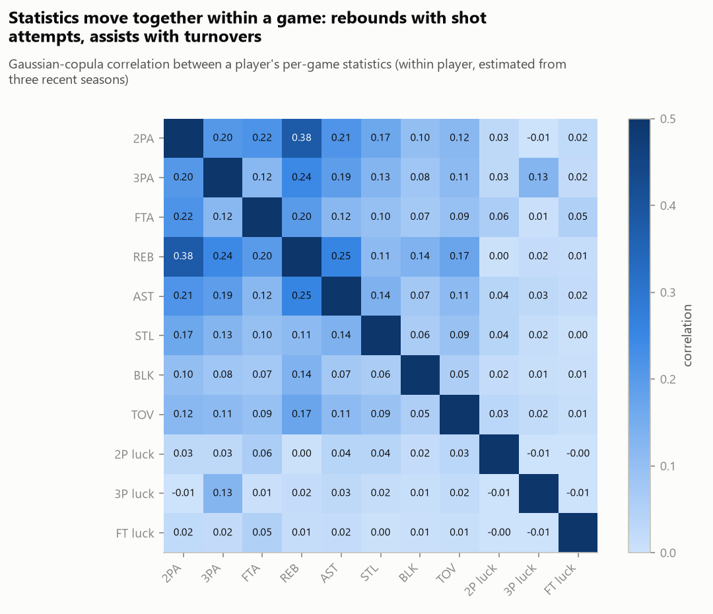

*Figure 26. Correlation matrix of the Gaussian copula: the dependence between a player's statistics within a game.*


## 9.3 The calendar

Matchup periods are Monday-to-Sunday weeks with two exceptions that the code reproduces from the published schedule: the **NBA Cup knockout stretch** is merged with the week before it (week 7, 30 November to 13 December) and the **All-Star break** is a two-week matchup (week 17, 15 to 28 February). Week 18 ends the regular season on 7 March, and the three playoff weeks run 8 to 28 March. About 30 Cup games are not yet on the published schedule; by the owner's instruction they are ignored, so week 7 is simulated with only its published games and is the noisiest week.


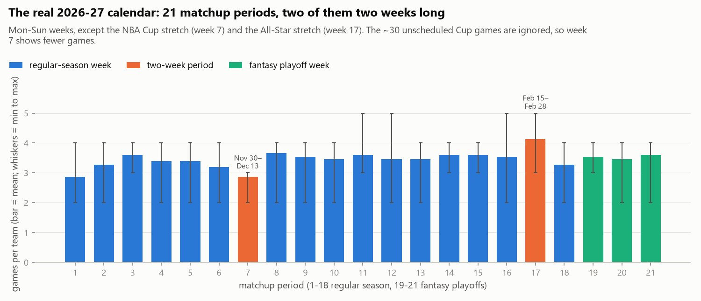

*Figure 27. Games per team in each of the 21 matchup periods (bar: mean; whiskers: minimum and maximum across teams).*


Using the real schedule matters because value depends on *which days* players play: if four centers all have games on the same night only a limited number can start; a week in which a roster's stars share off-days leaves lineup slots empty. That interaction is invisible in a season-average projection.

## 9.4 What a simulated player looks like


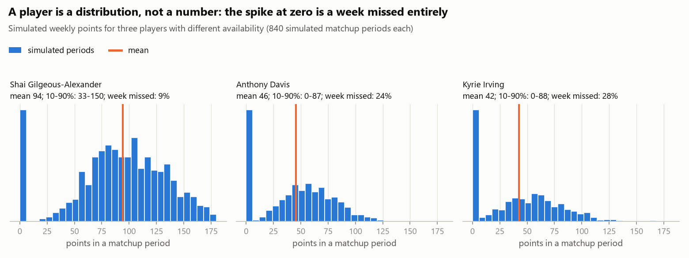

*Figure 28. Distribution of simulated weekly points for three players; the spike at zero is a period missed entirely.*


| player | availability | mean | 10th percentile | 90th percentile | weeks missed entirely |
|---|---|---|---|---|---|
| Shai Gilgeous-Alexander | 84% | 94 | 33 | 150 | 9% |
| Anthony Davis | 70% | 46 | 0 | 87 | 24% |
| Kyrie Irving | 58% | 42 | 0 | 88 | 28% |

## 9.5 Validation, part 1: does the library reproduce the projections? (and a bug it caught)

Simulating is only useful if the simulated *means* equal the projection. For every player the library's games per period should equal `avail × team games`, and its per-game line while playing should equal the projection (the talent and count noise are mean-preserving by construction). We check this for all 614 players (`library_diagnostics.py`). Games and every non-shooting statistic matched to within 0.4%, but the shooting statistics did not: **points ran 1.8% high, threes made 4.2% high, FG% 2.0% and FT% 1.5% high.**

**Diagnosis.** The projection's make rates are *ratios of totals*, which already contain how shot attempts and make rate move together in real data. The copula and the talent draw then *re-created* that correlation on top, so players who shoot more also shoot better in the simulation, which inflates makes. We confirmed the cause by switching the correlation structure off: with the copula correlation set to the identity matrix the discrepancy in made field goals fell from +0.9% to +0.1% (3PM: +2.6% to +0.5%); with both the copula and the talent correlation switched off every ratio was 1.000 (made FG 0.999, 3PM 0.999, FT 1.000).

**Fix.** A short pilot simulation estimates a multiplier for each of the 2-point, 3-point and free-throw make rates, rescaled (volume-weighted) until the simulated makes equal the projected makes, and the full library is then built with those multipliers (`estimate_make_scale`). After the correction the shipped library (recomputed for this report) is within 0.3% of the projection for every counting statistic and within 0.6% for the two percentages.


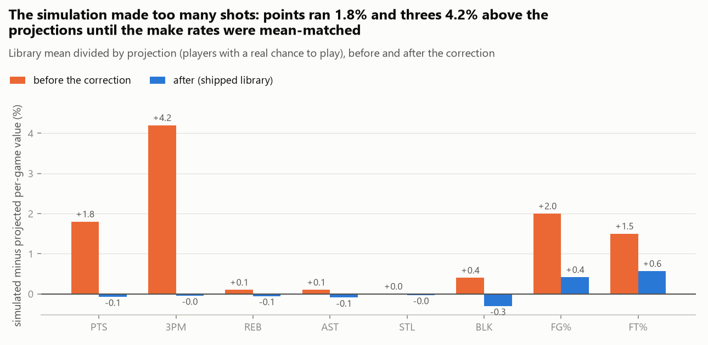

*Figure 29. Simulated minus projected per-game values, before and after the make-rate correction.*


## 9.6 Validation, part 2: is the *spread* realistic? A test on four past seasons

Matching the mean is necessary but not sufficient: the pick policy depends on how much weekly totals vary, how often categories are won, and how strongly categories move together. To test the spread on seasons the simulation did not see, we replay 2022-23 to 2025-26:

1. **Rebuild the season from pre-season information only.** Projections (section 3-4 pipeline, including the backtest that picks the models) use only earlier seasons; the simulation library is built from those projections with that season's *real schedule*, 100 simulated draws per matchup period.
2. **Draft realistic rosters.** For each season we mock-draft six 10-team leagues (60 rosters of 13 players) by taking the best available player by the board, with noisy bots.
3. **Score every roster twice with the same daily-lineup rules**: on the simulated periods and on the periods that really happened (the actual box scores).
4. **Compare, week by week.** For each roster, week and category we find where the *real* total falls inside the 100 simulated totals for that same week. That position is the **probability integral transform (PIT)**, a number in [0, 1] that is uniform if the simulated distribution is calibrated. In a PIT histogram a flat profile means calibration, a U-shape means the real values land in the tails too often (the simulation is too narrow), and a hump means it is too wide. Converting PITs to normal scores `Φ⁻¹(PIT)` gives a variable with variance 1 under calibration.

*A benchmark we had to add.* To read the numbers we need the value a *perfectly calibrated* simulation would produce with this machinery. We obtain it by treating one simulated draw as if it were reality and placing it among the other 99 (leave-one-out PIT): its normal-score variance is **1.026** and its mean PIT 0.503, close to the ideal 1 and 0.5, which confirms the test itself is unbiased. (A first version of this test compared the correlation between categories with zero; that was wrong, because categories legitimately move together with games played, and the correct benchmark is the simulation's own correlation.)


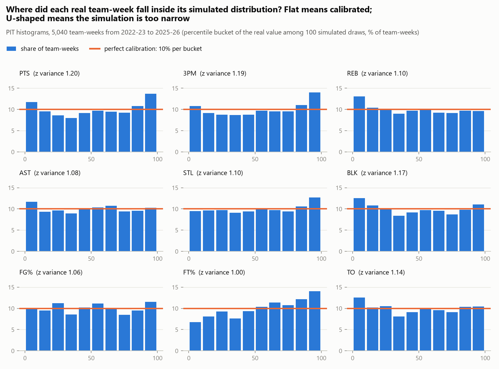

*Figure 30. PIT histograms by category for the real 2022-23 to 2025-26 team-weeks.*


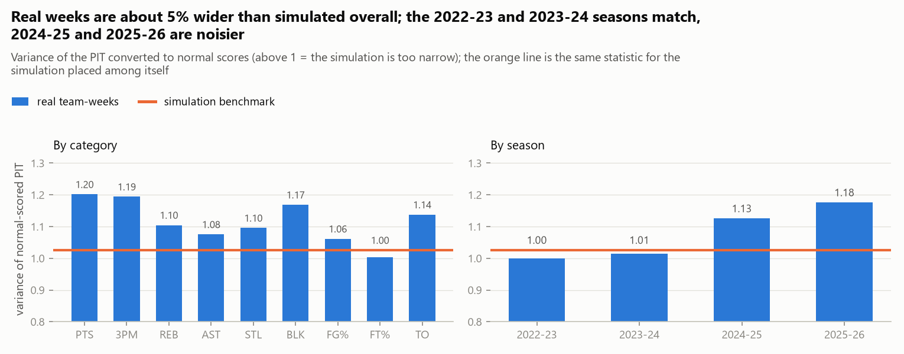

*Figure 31. Variance of the normal-scored PIT by category and by season, against the simulation's own benchmark (orange line).*


**Spread.** Pooled over 5,040 team-weeks the normal-score variance is **1.12** against the benchmark 1.03, so real weekly totals are about 5% wider than simulated; the central 50%, 80% and 90% simulated intervals contain 47%, 77% and 87% of real weeks (ideal 50/80/90). The shortfall is concentrated in points (1.20), threes (1.19) and blocks (1.17); free-throw percentage has the right spread (1.00) but a **bias**: its histogram tilts to the right (mean PIT 0.56, mean normal score +0.20), meaning that real rosters shoot free throws about 0.2 standard deviations better than the simulation expects (the pooled free-throw projections are slightly conservative). It also changes with the season: the 2022-23 and 2023-24 seasons are calibrated (1.00, 1.01) while 2024-25 and 2025-26 are noisier (1.13, 1.18); the calibration file is fit on all seasons, and more weekly variability in recent seasons (more rest and load management) is a plausible but untested explanation. The mean PIT also shifts from season to season (2022-23: 0.56, 2023-24: 0.56, 2024-25: 0.49, 2025-26: 0.42): league-wide scoring levels differ from the projections' level by season, which cancels in head-to-head matchups because both teams shift together.


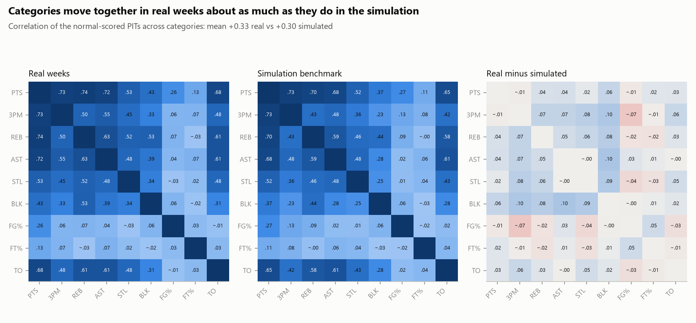

*Figure 32. Cross-category correlation of the normal-scored PITs: real weeks, the simulation benchmark, and the difference.*


**Dependence.** The average correlation between categories is **+0.33** in real weeks against **+0.30** in the simulation, and the largest differences (blocks with other counting categories) are about 0.1. The copula and the shared talent shocks therefore reproduce how categories rise and fall together.

**Matchups.** The quantity the draft engine ultimately uses is the probability that team A beats team B in a week. For every pair of teams, in every week, we compare the simulated probability (from all 100 x 100 pairings of simulated draws) with who actually won:


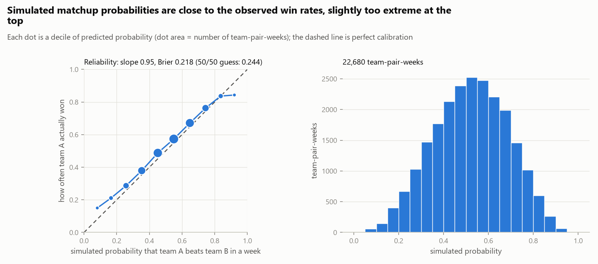

*Figure 33. Reliability diagram of simulated matchup probabilities against actual outcomes (left) and the distribution of the probabilities (right).*


| predicted probability | team-pair-weeks | mean predicted | actual win rate |
|---|---|---|---|
| 0.0-0.1 | 60 | 0.081 | 0.150 |
| 0.1-0.2 | 550 | 0.165 | 0.211 |
| 0.2-0.3 | 1,702 | 0.257 | 0.287 |
| 0.3-0.4 | 3,244 | 0.353 | 0.379 |
| 0.4-0.5 | 4,517 | 0.452 | 0.487 |
| 0.5-0.6 | 5,003 | 0.550 | 0.573 |
| 0.6-0.7 | 4,194 | 0.648 | 0.671 |
| 0.7-0.8 | 2,479 | 0.744 | 0.763 |
| 0.8-0.9 | 861 | 0.837 | 0.836 |
| 0.9-1.0 | 70 | 0.920 | 0.843 |

A logistic regression of the outcome on the log-odds of the simulated probability has slope **0.95** (1 = perfectly calibrated; below 1 means too extreme). The Brier score is 0.218, against 0.244 for always predicting 50%, and teams the simulation favoured by more than 5 points won 67.7% of 10,080 pairings. The probabilities are therefore informative and only slightly over-confident (about 5%); they are best read as a ranking of options rather than as exact probabilities. The extreme top bin (0.9-1.0, 70 team-pair-weeks) is the most over-confident.


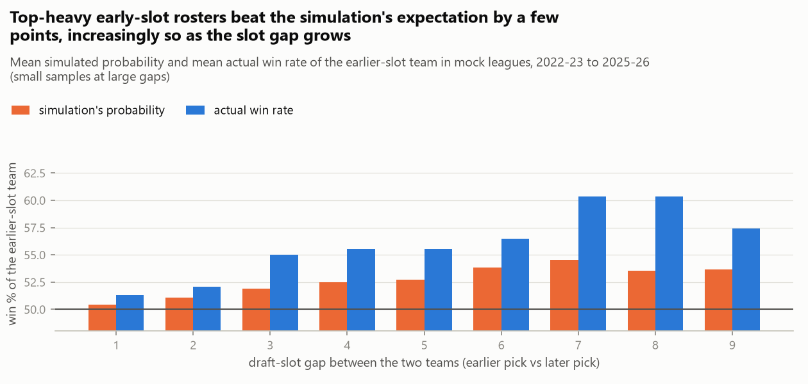

*Figure 34. Actual and simulated win rate of the earlier-draft-slot team, by the slot gap between the two teams.*


**One systematic pattern.** Early-slot (star-heavy) rosters beat the simulation's expectation by about 1 point at a gap of one slot and 3 to 6 points at larger gaps, so the real advantage of top-heavy rosters is somewhat larger than simulated (the samples at large gaps are small). We did not adjust for this; it suggests the simulation, if anything, undervalues stars slightly.

*An earlier lesson from the same test.* The first version of this check looked worse, with real weeks piling in the lowest and highest 10% buckets (15.8% and 15.2% in 2025-26). Widening the projection uncertainty did not help, which pointed at *availability* rather than talent: the whole-week absence share `c` had been estimated only from players with at least 25 games and only between their first and last appearance, silently excluding the long and season-ending injuries. Re-measured over every week of the season for every rotation player, `c` rose from 0.42 to 0.68, which reproduces the real 18-21% of zero-game weeks and roughly halved the distance from a flat histogram in every season.

# 10. Phase 3: from distributions to a draft decision

## 10.1 The objective

Because a weekly matchup is won by taking more than 4.5 of 9 categories, the engine maximises the **probability that my team wins a weekly matchup** against a random opponent, averaged over all simulated periods (the 18 regular-season and 3 playoff weeks equally weighted; there is no model of who qualifies for the playoffs). That differs usefully from "maximise total z-score": it rewards balance (five narrow category wins every week beat three huge ones), rewards depth (daily lineups mean bench players score when a starter is off), and treats a category that is certain to be lost as nearly free to ignore.

## 10.2 The decision loop

For each candidate pick the engine:

1. assumes I take him;
2. **rolls the rest of the draft forward**: every other team picks the best remaining player by a noisy preference order (ESPN's average draft position where available, otherwise our value rank, with noise that grows deeper in the draft), skipping any center that would be a fourth on that roster; my own later picks follow the board;
3. **plays all ten rosters through the simulated periods with daily lineups**: each day, in value order, every player with a game takes the first open slot he is eligible for (his dedicated position, then G or F, then UTIL); the rest sit, so bench players score whenever a starter has no game or is injured;
4. compares my weekly category totals with each opponent's (more than 4.5 categories wins; turnovers: fewer wins; FG% and FT% from summed makes and attempts);
5. repeats over two different sets of bot choices, using the same random numbers for every candidate so that *differences* between candidates are far less noisy than their absolute levels.

Every available player within board rank 200 is evaluated this way. At the first pick of slot 1:


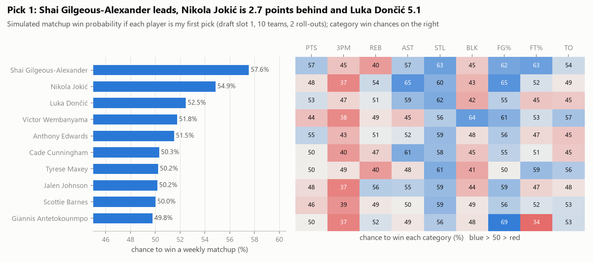

*Figure 35. Simulated matchup win probability of each top candidate for the first pick (left) and the chance of winning each category (right).*


The engine's ordering agrees closely with the board (Spearman ρ = 0.96 over the 200 candidates) but reorders it: it likes players whose categories are *complementary to the likely rest of the roster* and discounts those whose value is concentrated where many alternatives exist.

| player | board rank | engine rank | win % if my first pick |
|---|---|---|---|
| Shai Gilgeous-Alexander | 1 | 1 | 57.6 |
| Nikola Jokić | 2 | 2 | 54.9 |
| Luka Dončić | 4 | 3 | 52.5 |
| Victor Wembanyama | 3 | 4 | 51.8 |
| Anthony Edwards | 9 | 5 | 51.5 |
| Cade Cunningham | 13 | 6 | 50.3 |
| Tyrese Maxey | 5 | 7 | 50.2 |
| Jalen Johnson | 17 | 8 | 50.2 |
| Scottie Barnes | 7 | 9 | 50.0 |
| Giannis Antetokounmpo | 6 | 10 | 49.8 |
| Kon Knueppel | 23 | 11 | 49.3 |
| Chet Holmgren | 16 | 12 | 49.2 |

## 10.3 The first attempt: did the engine beat "take the best player left"?

The only honest test of a draft tool is whether it would have helped in a season it had not seen. For each past season we rebuild everything as of that preseason, run mock drafts twice with identical bots (taking the engine's pick at each turn versus simply taking the best-ranked player left, both respecting the three-center cap), and score the two rosters on the season's real box scores. The first complete validation (2022-23 to 2025-26, 96 drafts) was disappointing: the engine's *own* simulation predicted a gain of +3.6 points of weekly win probability, but on real box scores the gain was **−0.8 ± 1.7** points, indistinguishable from zero. Two lessons followed.

* **The argmax of noisy estimates is partly luck.** When two candidates' simulated win probabilities differ by less than the noise in the estimate, the "best" one is often just the luckiest. The engine gained a **guard**: it departs from the board only when its pick is clearly better, taking the best-ranked player among candidates within 1 point of the best simulated probability. With the guard the same drafts scored **+2.5 ± 1.3** points (figure below, orange versus aqua).
* **Simulation-world gains over-state real gains.** Evaluation inside the simulation that chose the pick is optimistic (a form of the "winner's curse"), so every test from here on scores picks on a *held-out* simulation (a different random draw of the same season) and, ultimately, on real box scores.

## 10.4 A category-aware pick policy

The engine needs seconds per pick and compares candidates on noisy simulated weeks. A cheaper idea is to ask directly: *given the roster I would end up with, which candidate gives me the best chance of winning at least five categories?* The **category-aware policy** does this at every pick:

1. Take the board's top six available players (more candidates did worse, see below).
2. For each, finish the draft with noise-free bots and my later picks in board order.
3. Total every team's weekly production from a stored table of **4,200 simulated weeks** (200 draws of each of the 21 periods; one weekly-total table is all the policy needs), weighting each roster slot by how much of its production the daily lineup really uses (1.00 for the ten best players and 0.97 for the bench: a 13-man roster has only about five players with a game on a given day, so almost every game finds a slot).
4. Score my team against the nine opponents week by week, `P(win > 4.5 of 9 categories)`, and take the best candidate **only if it beats the board's top choice by more than 0.5 points** (the guard).

Because the policy re-decides at every pick from the current roster, it behaves like a *punting* strategy where that is worth it, without fixing a punt in advance. In one mock draft from slot 4 (the owner's slot), with identical bots:


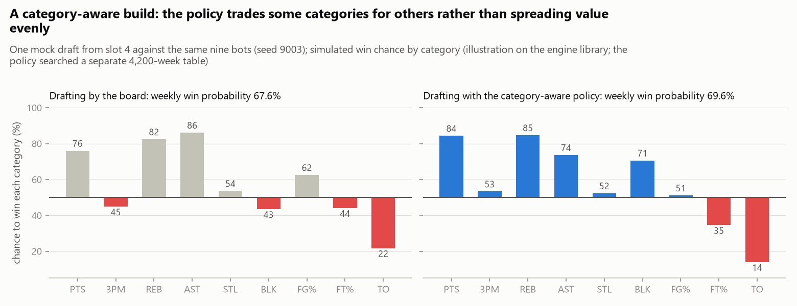

*Figure 36. Category win chances of the team drafted by the board and by the policy in one mock draft (slot 4, bot seed 9003).*


| board: player | board: board rank | policy: player | policy: board rank |
|---|---|---|---|
| Nikola Jokić | 2 | Nikola Jokić | 2 |
| Donovan Mitchell | 8 | Chet Holmgren | 16 |
| Jalen Johnson | 17 | Jalen Johnson | 17 |
| Cooper Flagg | 26 | Cooper Flagg | 26 |
| Devin Booker | 31 | Alperen Sengun | 32 |
| Tyrese Haliburton | 35 | Jayson Tatum | 47 |
| De'Aaron Fox | 43 | Matas Buzelis | 52 |
| Domantas Sabonis | 56 | Brandon Miller | 60 |
| Yaxel Lendeborg | 67 | AJ Dybantsa | 68 |
| Jabari Smith Jr. | 69 | Jaylen Brown | 82 |
| Jaylen Brown | 82 | Paolo Banchero | 91 |
| Paolo Banchero | 91 | Darryn Peterson | 105 |
| Ivica Zubac | 100 | Coby White | 113 |

The two teams share 5 of 13 players; the simulated weekly win probability is 67.6% by the board and 69.6% with the policy (a single draw, scored on the engine's own 840-week library, so illustrative only).

## 10.5 Choosing the policy's settings without fooling ourselves

Three settings matter: the number of simulated draws the policy searches, how many candidates it considers, and the size of the guard. All were tuned on **development** mock drafts (bot seeds 5000-5011 in each of the ten slots, 120 drafts per setting) and scored on a **held-out** library, then confirmed on **fresh** seeds that were never used to choose anything.


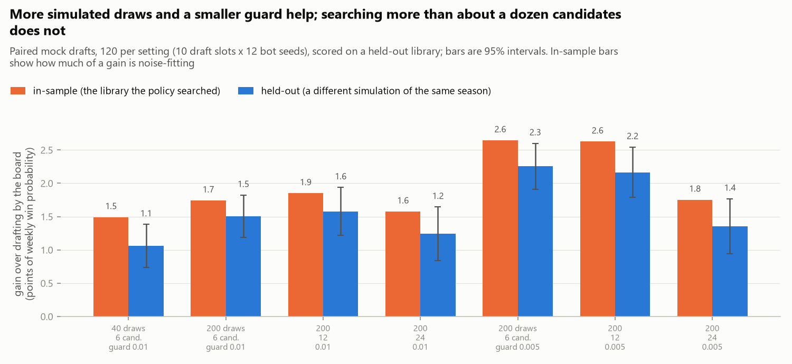

*Figure 37. Gain over drafting by the board for seven settings of the policy; blue bars are scored on a held-out library, orange on the library the policy searched.*


* **More simulated draws help.** Going from 40 to 200 draws per week raises the held-out gain from 1.1 to 1.5 points with the same candidates and guard, and shrinks the in-sample-versus-held-out gap (the amount of noise-fitting) from 0.4 to 0.2 points.
* **With 200 draws a smaller guard helps** (0.005 beats 0.01 by about 0.7 points for 6 candidates).
* **More than about a dozen candidates hurts.** With 24 candidates the gain falls back toward the old level. Each additional candidate is another chance for a noisy estimate to beat the board by luck; this is the multiple-comparisons problem in miniature.

The best of seven settings on shared drafts is biased upward (selecting a winner from seven on the same data), so the confirmation on fresh seeds matters:


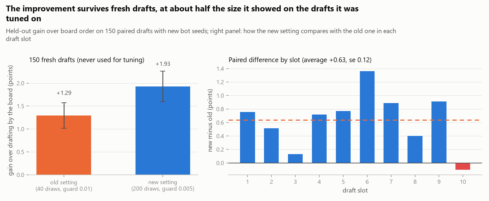

*Figure 38. Confirmation on 150 fresh paired drafts: old versus new setting, and their difference by draft slot.*


On the fresh drafts the new setting gains **+1.93 ± 0.17** points against **+1.29 ± 0.14** for the old setting, a paired difference of **+0.63 ± 0.12** points (better in 64% of drafts and in 9 of 10 draft slots). That is about half of the +1.2 points the same comparison showed on the development drafts: the other half was selection luck. We report the fresh number.

## 10.6 A negative result: considering every player up to rank 200 does not find better picks

The owner's preference was that every player up to rank 200 be considered at each pick. We tested whether evaluating all of them improves the *engine's* choices over a short list of 20:


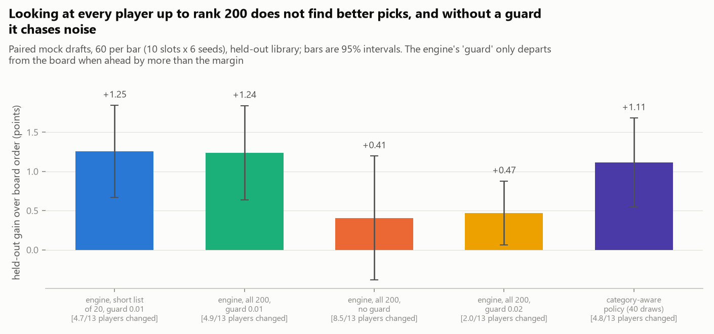

*Figure 39. Held-out gain over board order for the engine with a short candidate list, with all players up to rank 200 (three guard sizes), and for the 40-draw policy.*


With the 1-point guard the 200-wide search scores the same as the short list (+1.24 versus +1.25 points), and without the guard it changes about twice as many players and does *worse* (+0.41). So the application shows every player up to rank 200 in its table, which costs nothing, but the recommended pick comes from a guarded rule. A caution about our own process: an interim reading of this experiment at 31 to 43 of 60 drafts (draft slots 1 to 8 only) had the policy at about twice the engine's gain; that lead vanished when slots 9 and 10 completed, and the final 60-draft result has the guarded engine and the 40-draw policy equal within noise. Interim results from a subset of conditions should not be trusted.

## 10.7 Validation on real seasons (never used for tuning)

The decisive test is again real box scores. For each of 2021-22 to 2025-26 we draft 40 mock leagues for each rule (policy rows use the same bots as the board team) and score the rosters on what really happened:


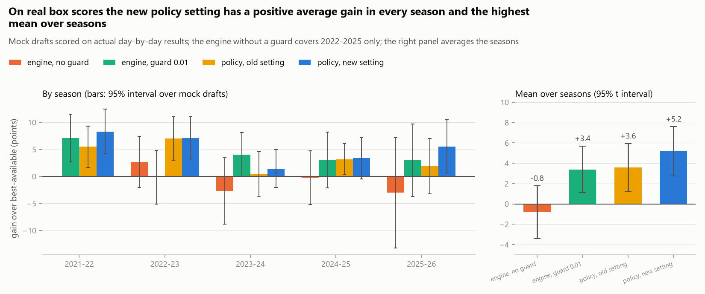

*Figure 40. Gain over 'take the best player left' on actual box scores, by season (left) and averaged over seasons (right).*


| season | engine, no guard | engine, guard 0.01 | policy, old setting | policy, new setting |
|---|---|---|---|---|
| 2021-22 |  | +7.1 | +5.5 | +8.3 |
| 2022-23 | +2.7 | -0.2 | +7.0 | +7.1 |
| 2023-24 | -2.7 | +4.1 | +0.4 | +1.5 |
| 2024-25 | -0.2 | +3.0 | +3.2 | +3.4 |
| 2025-26 | -3.0 | +3.0 | +1.9 | +5.5 |

| rule | seasons | mean gain (points) | se across seasons | t | p (two-sided) | seasons positive |
|---|---|---|---|---|---|---|
| engine, no guard | 4 | -0.8 | 1.3 | -0.6 | 0.579 | 1 of 4 |
| engine, guard 0.01 | 5 | +3.4 | 1.2 | 2.9 | 0.044 | 4 of 5 |
| policy, old setting | 5 | +3.6 | 1.2 | 3.0 | 0.040 | 5 of 5 |
| policy, new setting | 5 | +5.2 | 1.2 | 4.2 | 0.014 | 5 of 5 |

How much evidence is this? The 160-plus mock drafts per rule are *not* independent: all drafts in a season face the same real outcomes (an injury to a star hurts every roster that holds him), so the honest unit of evidence is the **season**, and there are five. Treating each season's mean gain as one observation, the new policy setting averages **+5.2 points (standard error 1.2, t = 4.2 on 4 degrees of freedom, p = 0.014)** and is positive in 5 of 5 seasons; the old setting averages +3.6. The engine's guard result is similar (+3.4), and removing the guard turns the engine's gain into roughly zero. These settings were chosen on *simulated* drafts of 2026-27, not on these real seasons, so the real-season results are out of sample for the settings (the engine's 1-point guard is the exception: it was chosen after viewing the 2022-25 results, so only 2021-22 is clean for it). Five seasons are enough to rule out a large harm, not to measure a small gain precisely, and the calibration of the simulation (section 9) was fitted on all seasons, so the replay is not strictly out of sample.

**Which rule is used?** The application's "Best pick" is the category-aware policy (a sidebar switch selects the engine's guarded pick instead); both rules are statistically equivalent in our tests, the policy being about 350 times faster. The table of win probabilities for every player up to rank 200 is shown next to it.


# 11. Results: the 2026-27 board against the market

## 11.1 The reference

The *market* is the blended average draft position (ADP) of three sites (Yahoo, ESPN and Fantrax) on 14 October 2026, converted to an *order* (1 = first player off the board). 98 of the 422 players in the workbook carry an ADP between 139 and 141, which the source uses as a placeholder for rarely drafted players, so they are excluded (the note on the figure counts the 94 of them that match a player in our pool). The market is **not ground truth**: it is the average opinion of other drafters, with their biases and herding, so a disagreement is a question, not an error. It was never an input to any model here. What the comparison can tell us is where our independent projection differs from consensus and whether the differences are explainable. The comparison covers the 167 players who are within the market's or our top 150.


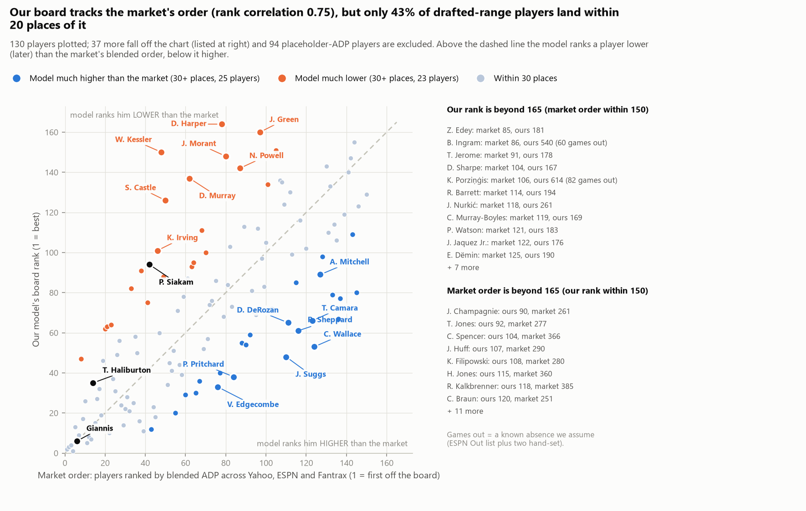

*Figure 41. Our board rank against the market's blended order. Above the dashed line the model ranks a player lower than the market; below it, higher. Players off the chart are listed at the right.*


**Overall agreement.** The rank correlation between our board and the market is **ρ = 0.75** over the 167 players (0.75 for the market's first 130, the players a 10-team, 13-round draft takes). The median absolute gap in that drafted range is **25 places**; 22% of players are within 10 places of the market, 43% within 20 and 72% within 40. Of the market's top 30, we have **19 in our top 30 and 23 in our top 40**. A correlation of 0.75 says the two are measuring the same thing but differ substantially, which is the expected pattern: nearly everyone agrees about the stars, and the middle of a draft is mostly opinion about role, health and age.


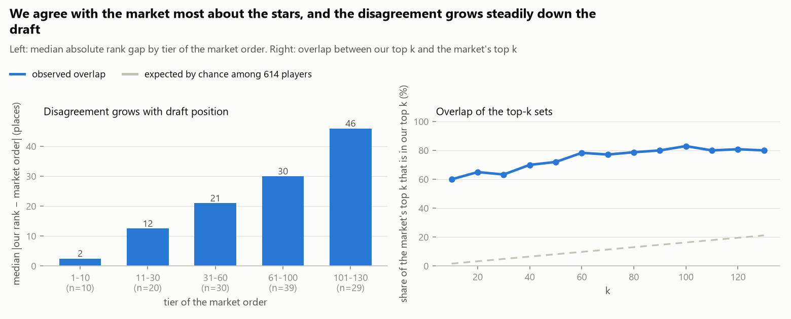

*Figure 42. Median disagreement by tier of the market order (left) and overlap of the top-k sets (right).*


Agreement is strongest at the top (median gap 2 places for the market's top 10) and the gap grows tier by tier (21 for market order 31-60, 30 for 61-100, 46 for 101-130): the later a player goes, the more his draft position rests on role and opinion. The top-10 sets share 6 players and the top-30 sets 19; the overlap rises with k only because larger sets are harder to miss, and it stays far above what chance would give.

## 11.2 The market's top 30 side by side

| market order | player | our rank | our rank − market | per-game rank* | age | proj MPG | proj GP |
|---|---|---|---|---|---|---|---|
| 1 | Nikola Jokić | 2 | +1 | 3 | 32 | 34.5 | 67 |
| 2 | Victor Wembanyama | 3 | +1 | 1 | 23 | 30.7 | 57 |
| 3 | Luka Dončić | 4 | +1 | 4 | 28 | 35.7 | 61 |
| 4 | Shai Gilgeous-Alexander | 1 | -3 | 2 | 28 | 33.7 | 69 |
| 5 | Cade Cunningham | 13 | +8 | 15 | 25 | 34.4 | 63 |
| 6 | Giannis Antetokounmpo | 6 | +0 | 10 | 32 | 33.0 | 65 |
| 7 | Anthony Edwards | 9 | +2 | 14 | 25 | 35.7 | 65 |
| 8 | Jayson Tatum | 47 | +39 | 28 | 29 | 32.4 | 58 |
| 9 | Jalen Johnson | 17 | +8 | 12 | 25 | 35.4 | 61 |
| 10 | Cooper Flagg | 26 | +16 | 21 | 20 | 34.2 | 61 |
| 11 | Tyrese Maxey | 5 | -6 | 5 | 26 | 37.1 | 60 |
| 12 | Donovan Mitchell | 8 | -4 | 7 | 30 | 32.8 | 62 |
| 13 | Scottie Barnes | 7 | -6 | 9 | 25 | 33.6 | 65 |
| 14 | Tyrese Haliburton | 35 | +21 | 26 | 27 | 29.8 | 59 |
| 15 | Kevin Durant | 15 | +0 | 22 | 38 | 34.4 | 65 |
| 16 | Karl-Anthony Towns | 27 | +11 | 19 | 31 | 30.8 | 60 |
| 17 | Alperen Sengun | 32 | +15 | 48 | 24 | 32.5 | 67 |
| 18 | Amen Thompson | 19 | +1 | 24 | 24 | 34.9 | 65 |
| 19 | Jalen Brunson | 46 | +27 | 47 | 30 | 33.9 | 63 |
| 20 | LaMelo Ball | 62 | +42 | 39 | 25 | 28.8 | 57 |
| 21 | Trae Young | 63 | +42 | 62 | 28 | 30.7 | 63 |
| 22 | Jamal Murray | 10 | -12 | 11 | 30 | 34.6 | 63 |
| 23 | Josh Giddey | 64 | +41 | 60 | 24 | 30.9 | 62 |
| 24 | Stephen Curry | 37 | +13 | 20 | 39 | 29.9 | 57 |
| 25 | Devin Booker | 31 | +6 | 33 | 30 | 34.0 | 63 |
| 26 | Austin Reaves | 49 | +23 | 44 | 29 | 32.5 | 62 |
| 27 | Domantas Sabonis | 56 | +29 | 56 | 31 | 30.1 | 64 |
| 28 | Bam Adebayo | 24 | -4 | 32 | 29 | 32.2 | 68 |
| 29 | Kawhi Leonard | 14 | -15 | 6 | 36 | 29.9 | 59 |
| 30 | James Harden | 22 | -8 | 27 | 37 | 33.4 | 65 |

\*Per-game rank = the player's board rank if every player in the pool were available for every game. Comparing it with the board rank separates a disagreement about how well a player plays from one about how often he plays.

Our top four (Shai Gilgeous-Alexander, Nikola Jokić, Victor Wembanyama, Luka Dončić) are exactly the market's top four, in a different order; the model has Shai Gilgeous-Alexander first where the market has him 4th. The **largest disagreements inside the market's top 30** are the 10 players that we rank 15 or more places lower than the market (Trae Young 21→63, LaMelo Ball 20→62, Josh Giddey 23→64, Jayson Tatum 8→47, Domantas Sabonis 27→56, Jalen Brunson 19→46, Austin Reaves 26→49, Tyrese Haliburton 14→35, Cooper Flagg 10→26, Alperen Sengun 17→32). The per-game rank separates two kinds of disagreement:

* **Games and minutes** (LaMelo Ball, Jayson Tatum, Tyrese Haliburton). Their per-game ranks are at least 8 places better than their board ranks, so the gap is mainly projected availability and minutes. Jayson Tatum had 16 games at 32.6 MPG in 2025-26 and is projected for 58 games (at 65 games he would be 24th); LaMelo Ball is projected for 28.8 minutes and 57 games; Haliburton is the returner discussed in section 11.4.
* **Category fit** (Trae Young, Josh Giddey, Domantas Sabonis, Jalen Brunson, Austin Reaves, Cooper Flagg, Alperen Sengun). Their per-game ranks are at most 5 places better than their board ranks, so availability is not the issue: in a nine-category format their production is worth less than their reputation. The table and figure below show what offsets their points and assists. Trae Young and Josh Giddey are elite assist men whose turnovers cost them a z-score of −2.1 each; LaMelo Ball and Jayson Tatum give back value in field-goal percentage; Domantas Sabonis is a rebounding and field-goal-percentage specialist with negative threes and turnovers; and Jalen Brunson and Austin Reaves are well-rounded scorers without a single category above +1.7 and +1.3 respectively, so they add up to a moderate total.

| player | market | our rank | per-game rank* | proj MPG | proj GP | strongest categories (z) | weakest categories (z) |
|---|---|---|---|---|---|---|---|
| Trae Young | 21 | 63 | 62 | 30.7 | 63 | AST +2.8, FT% +1.3 | TO -2.1, REB -1.3 |
| LaMelo Ball | 20 | 62 | 39 | 28.8 | 57 | 3PM +1.9, AST +1.2 | FG% -1.7, BLK -0.9 |
| Josh Giddey | 23 | 64 | 60 | 30.9 | 62 | AST +2.3, REB +1.0 | TO -2.1, FG% -0.7 |
| Jayson Tatum | 8 | 47 | 28 | 32.4 | 58 | 3PM +1.1, PTS +1.0 | FG% -1.0, TO -0.8 |
| Domantas Sabonis | 27 | 56 | 56 | 30.1 | 64 | REB +2.7, FG% +1.8 | TO -1.3, 3PM -1.2 |
| Jalen Brunson | 19 | 46 | 47 | 33.9 | 63 | PTS +1.7, AST +1.4 | BLK -1.1, REB -1.1 |
| Austin Reaves | 26 | 49 | 44 | 32.5 | 62 | FT% +1.3, AST +0.7 | BLK -0.8, TO -0.7 |
| Tyrese Haliburton | 14 | 35 | 26 | 29.8 | 59 | AST +2.2, 3PM +0.8 | REB -1.1, FG% -0.6 |
| Cooper Flagg | 10 | 26 | 21 | 34.2 | 61 | PTS +1.5, AST +0.6 | TO -1.2, 3PM -0.3 |
| Alperen Sengun | 17 | 32 | 48 | 32.5 | 67 | REB +1.9, FG% +1.3 | FT% -2.2, TO -1.7 |


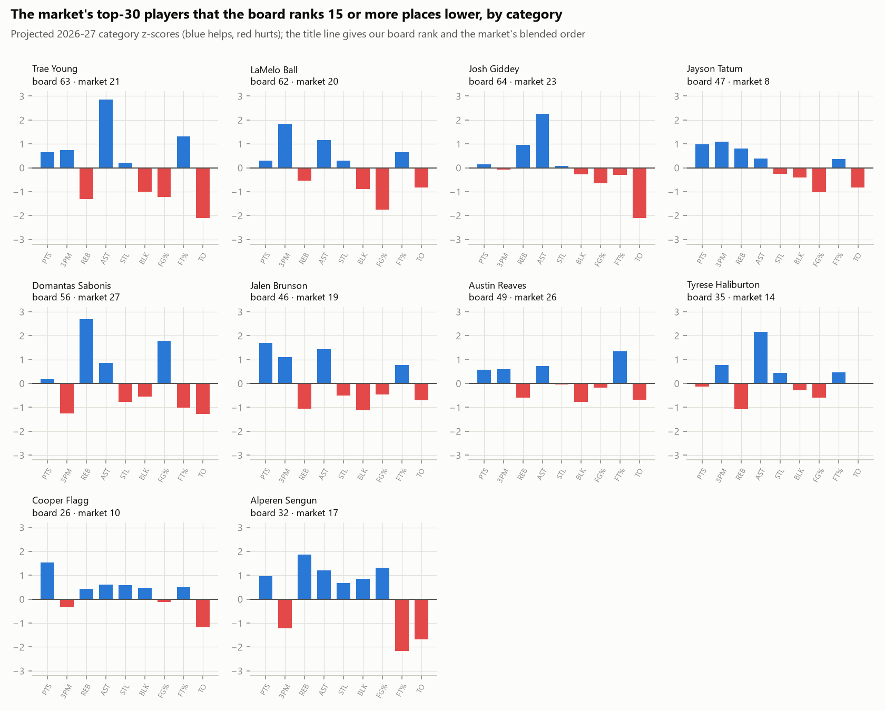

*Figure 43. Category z-scores of the market's top-30 players that the board ranks 15 or more places lower.*


On the other side, the model is higher than the market on Kawhi Leonard (market 29, ours 14, per-game rank 6, age 36), Jamal Murray (market 22, ours 10, per-game rank 11, age 30), James Harden (market 30, ours 22, per-game rank 27, age 37). Their per-game ranks are all inside the top 27, so the model values them highly when they play; 2 of the 3 are 36 or older, and the market appears to discount age and availability more heavily than the model does.

## 11.3 Where we disagree beyond the top 30, and the pattern behind it


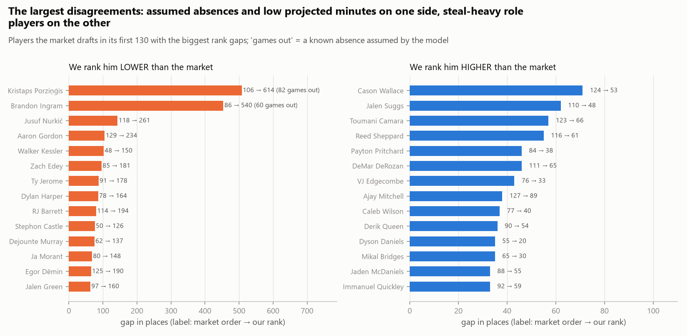

*Figure 44. The 14 largest disagreements in each direction, among players the market drafts in the first 130.*


The profile of the disagreements of 30 places or more shows what separates the groups:

| group | players | mean age | share age 31+ | share age ≤ 24 | mean proj MPG | mean proj GP | share with an assumed absence ≥ 20 games |
|---|---|---|---|---|---|---|---|
| we rank him 30+ places LOWER | 36 | 28.2 | 31% | 19% | 27.7 | 54 | 6% |
| we rank him 30+ places HIGHER | 20 | 25.9 | 5% | 35% | 30.3 | 67 | 0% |
| everyone else in the drafted range | 72 | 28.3 | 25% | 21% | 30.6 | 63 | 0% |

The 36 players we rank much lower have the *fewest projected games* (54, against 63 for the rest of the drafted range) and lower projected minutes (27.7 against 30.6); the 20 players we rank much higher have the most games (67) and are young more often (35% are 24 or under, against 21%). Only 2 of the 36 lower-ranked players carry a known absence (Brandon Ingram, Kristaps Porziņģis), but they account for the two largest gaps in the table below; 8 of the 14 players in the table are projected for 26.5 minutes or fewer. The main disagreement with the market is therefore **how much playing time to expect**, which is exactly where a projection built from past minutes and games (with shrinkage toward typical roles) and a market that rewards perceived upside should differ.

| player | market order | our rank | gap (places) | profile |
|---|---|---|---|---|
| Kristaps Porziņģis | 106 | 614 | +508 | assumed out 82 games; age 31; 25 MPG, 0 GP |
| Brandon Ingram | 86 | 540 | +454 | assumed out 60 games; 33 MPG, 16 GP |
| Jusuf Nurkić | 118 | 261 | +143 | age 32; 23 MPG, 48 GP |
| Aaron Gordon | 129 | 234 | +105 | age 31; 26 MPG, 53 GP |
| Walker Kessler | 48 | 150 | +102 | 23 MPG, 52 GP |
| Zach Edey | 85 | 181 | +96 | 22 MPG, 50 GP |
| Ty Jerome | 91 | 178 | +87 | 21 MPG, 52 GP |
| Dylan Harper | 78 | 164 | +86 | age 21; 24 MPG, 60 GP |
| RJ Barrett | 114 | 194 | +80 | 30 MPG, 57 GP |
| Stephon Castle | 50 | 126 | +76 | age 22; 29 MPG, 66 GP |
| Dejounte Murray | 62 | 137 | +75 | 29 MPG, 50 GP |
| Ja Morant | 80 | 148 | +68 | 27 MPG, 54 GP |
| Egor Dëmin | 125 | 190 | +65 | age 21; 26 MPG, 58 GP |
| Jalen Green | 97 | 160 | +63 | 29 MPG, 58 GP |

**Players we rank higher** have steady full-time roles (26 to 35 projected minutes and 64 to 72 games, across the 14 largest gaps) and a particular strength: 6 of the ten players tabulated below have steals among their two best categories.

| player | market order | our rank | gap (places) | profile |
|---|---|---|---|---|
| Cason Wallace | 124 | 53 | -71 | age 23; 28 MPG, 68 GP |
| Jalen Suggs | 110 | 48 | -62 | 28 MPG, 64 GP |
| Toumani Camara | 123 | 66 | -57 | 33 MPG, 70 GP |
| Reed Sheppard | 116 | 61 | -55 | age 23; 26 MPG, 65 GP |
| Payton Pritchard | 84 | 38 | -46 | 30 MPG, 72 GP |
| DeMar DeRozan | 111 | 65 | -46 | age 37; 31 MPG, 69 GP |
| VJ Edgecombe | 76 | 33 | -43 | age 21; 35 MPG, 65 GP |
| Ajay Mitchell | 127 | 89 | -38 | 26 MPG, 64 GP |
| Caleb Wilson | 77 | 40 | -37 | 28 MPG, 69 GP |
| Derik Queen | 90 | 54 | -36 | age 22; 27 MPG, 69 GP |
| Dyson Daniels | 55 | 20 | -35 | age 24; 33 MPG, 66 GP |
| Mikal Bridges | 65 | 30 | -35 | 33 MPG, 70 GP |
| Jaden McDaniels | 88 | 55 | -33 | 31 MPG, 66 GP |
| Immanuel Quickley | 92 | 59 | -33 | 31 MPG, 64 GP |

| player | market order | our rank | age | proj MPG | proj PPG | strongest categories (z) |
|---|---|---|---|---|---|---|
| Cason Wallace | 124 | 53 | 23 | 27.5 | 10.2 | STL +2.9, TO +1.1 |
| Jalen Suggs | 110 | 48 | 26 | 27.7 | 14.0 | STL +2.0, 3PM +0.5 |
| Toumani Camara | 123 | 66 | 27 | 32.6 | 13.7 | STL +1.3, 3PM +1.0 |
| Reed Sheppard | 116 | 61 | 23 | 26.1 | 13.4 | STL +1.5, 3PM +1.2 |
| Payton Pritchard | 84 | 38 | 29 | 30.4 | 17.6 | 3PM +1.9, AST +1.0 |
| DeMar DeRozan | 111 | 65 | 37 | 30.5 | 17.0 | FT% +1.2, TO +0.6 |
| VJ Edgecombe | 76 | 33 | 21 | 34.6 | 17.1 | STL +1.5, 3PM +0.6 |
| Ajay Mitchell | 127 | 89 | 25 | 25.6 | 13.3 | TO +0.7, STL +0.6 |
| Caleb Wilson | 77 | 40 |  | 28.0 | 15.3 | BLK +2.2, REB +1.0 |
| Derik Queen | 90 | 54 | 22 | 26.6 | 13.6 | REB +1.2, BLK +1.0 |

These "model likes" cases have not been stress-tested the way the "model dislikes" cases were, so they are hypotheses about where the market may be underpricing role and category fit, not established edges. The realism test also found that the simulation, if anything, under-credits top-heavy rosters (section 9.6), which is a reason for caution about trading stars for role players on this basis.

## 11.4 Case studies: seven players the board ranks far below the market

For each player we ask what drives the gap and what would close it. Rankings are on the board of 614 projected players. Each *what-if* changes only that player's minutes and/or games, with everyone else unchanged.


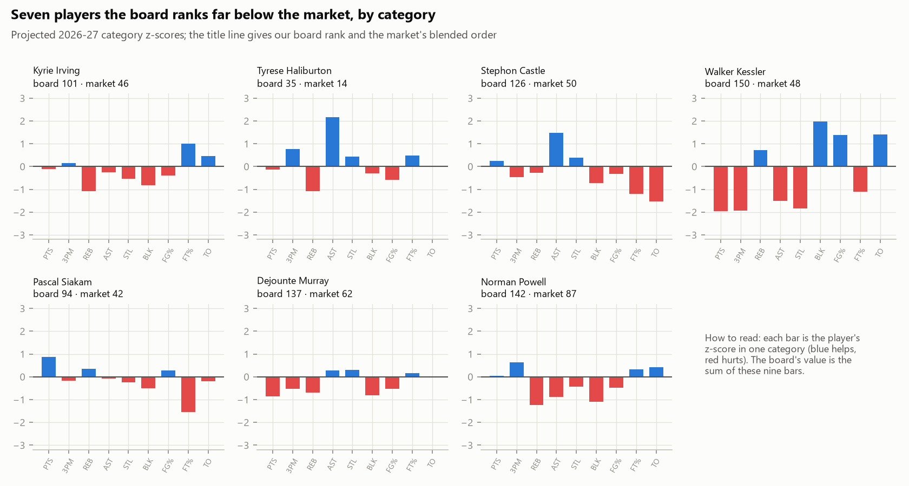

*Figure 45. Category z-scores for seven players ranked far below the market.*


| player | age | proj MPG | proj PPG | proj GP | 2025-26 | board rank | per-game rank* | market order | board rank at 82% of games |
|---|---|---|---|---|---|---|---|---|---|
| Kyrie Irving | 35 | 30.2 | 20.9 | 48 | did not play | 101 | 34 | 46 | 26 |
| Tyrese Haliburton | 27 | 29.8 | 16.7 | 59 | did not play | 35 | 26 | 14 | 17 |
| Stephon Castle | 22 | 29.1 | 17.0 | 66 | 68 GP, 29.9 MPG | 126 | 160 | 50 | 120 |
| Walker Kessler | 25 | 23.4 | 7.9 | 52 | 5 GP, 31.0 MPG | 150 | 100 | 48 | 71 |
| Pascal Siakam | 33 | 31.9 | 21.3 | 62 | 62 GP, 33.2 MPG | 94 | 98 | 42 | 71 |
| Dejounte Murray | 30 | 28.8 | 15.2 | 50 | 14 GP, 27.9 MPG | 137 | 73 | 62 | 59 |
| Norman Powell | 34 | 28.1 | 18.6 | 57 | 58 GP, 29.6 MPG | 142 | 125 | 87 | 89 |

* **Kyrie Irving (age 35; board 101, market 46).** A returner: no games in 2025-26 and 50 games at 36.0 MPG in 2024-25. The model projects 48 games at 30.2 MPG. Per game he would rank 34th if everyone played every game, so the gap to the market is mostly games and minutes: at 82% of games he would be 26th and at 65 games 29th. Strongest categories FT% +1.0, TO +0.5, 3PM +0.1; weakest REB -1.1, BLK -0.8, STL -0.5. The backtest supports the *direction* of both adjustments (section 5.4); it cannot tell us how Kyrie specifically has recovered.
* **Tyrese Haliburton (age 27; board 35 after the owner's override, 62 before; market 14).** Also a returner: no games in 2025-26 and 73 games at 33.6 MPG in 2024-25. The model's own minutes (26.3, against a recency baseline of 31.1) came entirely from the blank last-season slot (section 5.4); the owner's 29.8 is described in section 7.2. The sensitivity is large (figure below): at 26.3, 30 and 34 minutes his board rank would be 62, 32 and 13. Strongest categories AST +2.2, 3PM +0.8, FT% +0.5.
* **Stephon Castle (age 22; board 126, market 50).** Not an availability story: 68 games at 29.9 MPG in 2025-26 and 66 games projected. His per-game rank is 160th, below his board rank, because assists are his one strong category (strongest AST +1.5, STL +0.4, PTS +0.2) while the weakest (TO -1.5, FT% -1.2, BLK -0.7) cost almost as much. Even at 30 minutes he would be 118th. As a third-season player he is in the group the model slightly under-projects (section 5.5), but a full correction would move him only about nine places, so the gap is mainly a bet on growth that the model can only partly credit.
* **Walker Kessler (age 25; board 150, market 48).** 58 games at 30.1 MPG in 2024-25, but only 5 games at 31.0 MPG in 2025-26. The model projects 23.4 MPG and 52 games. His value depends heavily on minutes: strongest BLK +2.0, TO +1.4, FG% +1.4; weakest PTS -2.0, 3PM -1.9, STL -1.8. At 30 minutes he would be 73rd, and at 30 minutes and 65 games 28th. This is the largest single gap of the seven and is mainly a bet on his role.
* **Pascal Siakam (age 33; board 94, market 42).** 62 games at 33.2 MPG in 2025-26 (24.0 PPG, 69.3% from the line); projected 31.9 MPG, 21.3 PPG and 62 games. The free-throw category costs him the most (weakest FT% -1.5, BLK -0.5, STL -0.2). With a larger role (34 minutes, 70 games) he would be 51st. The projection mostly repeats his own recent record, and we found no model error.
* **Dejounte Murray (age 30; board 137, market 62).** 78 games at 35.7 MPG in 2023-24, 31 games at 32.6 MPG in 2024-25 and 14 games at 27.9 MPG in 2025-26. Projected 50 games at 28.8 MPG. His per-game rank is 73rd, so the games discount is what pushes him out of the drafted range; at 65 games he would be 63rd. The team-context features reduced his projected games by five to six (section 5.5).
* **Norman Powell (age 34; board 142, market 87).** 58 games at 29.6 MPG in 2025-26 (21.7 PPG); projected 28.1 MPG, 18.6 PPG and 57 games. His per-game rank is only 125th (weakest REB -1.2, BLK -1.1, AST -0.9) and age and games reduce it further; the context features also trimmed his games by five to six. The ablation of section 5.5 showed that the features improve games-played projections overall, so the change was kept. At 30 minutes and 65 games he would be 77th.


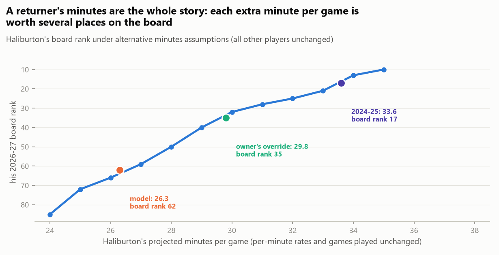

*Figure 46. Haliburton's board rank under alternative minutes assumptions.*


# 12. Last season's biggest jumpers and fallers

We compare each player's *actual* 2025-26 production with his 2026-27 projection, both z-scored within the same pool (the 275 players with at least 1,000 minutes last season, so ranks in this section are within that pool and differ from the board ranks above). Two lenses are shown because a player's fantasy value changes for two reasons: he plays better or worse per game, or he plays more or fewer games.

## 12.1 Total fantasy value (what you actually draft)


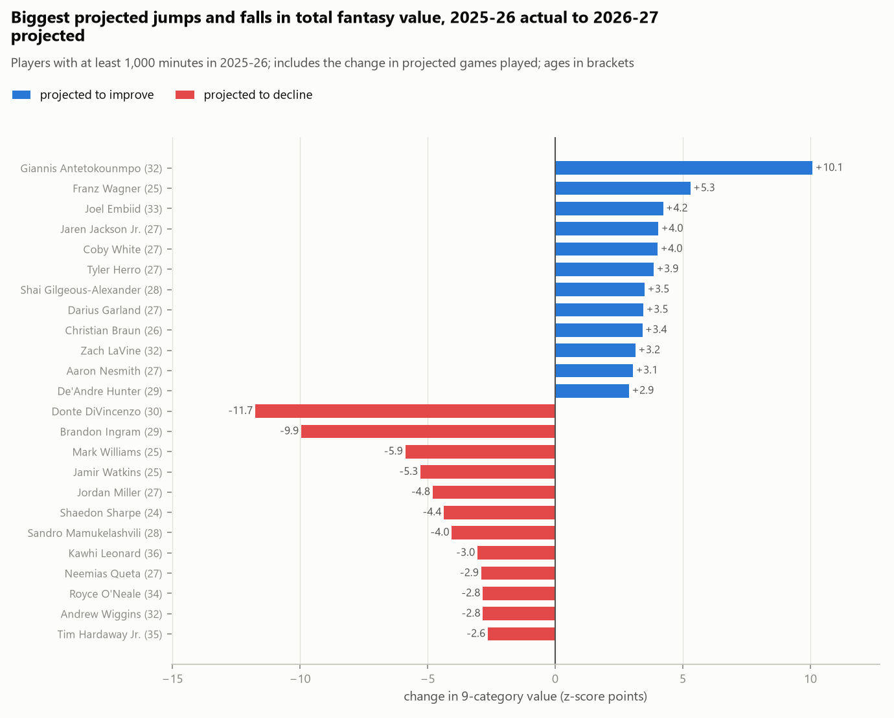

*Figure 47. Biggest projected changes in total value, 2025-26 actual to 2026-27 projected.*


**Biggest risers**

| player | age | rank 2025-26 | rank 2026-27 | Δ value | MPG | GP | biggest category swings |
|---|---|---|---|---|---|---|---|
| Giannis Antetokounmpo | 32 | 221 | 6 | +10.1 | 28.9 → 33.0 | 36 → 65 | -FT%, +REB |
| Franz Wagner | 25 | 238 | 62 | +5.3 | 30.0 → 29.6 | 34 → 59 | +PTS, +STL |
| Joel Embiid | 33 | 140 | 43 | +4.2 | 31.5 → 29.4 | 38 → 52 | +REB, +BLK |
| Jaren Jackson Jr. | 27 | 121 | 38 | +4.0 | 30.3 → 29.8 | 48 → 61 | +STL, +BLK |
| Coby White | 27 | 249 | 104 | +4.0 | 25.0 → 28.9 | 50 → 62 | +PTS, +3PM |
| Tyler Herro | 27 | 226 | 86 | +3.9 | 31.2 → 30.4 | 33 → 55 | +PTS, +3PM |
| Shai Gilgeous-Alexander | 28 | 2 | 1 | +3.5 | 33.2 → 33.7 | 68 → 69 | +STL, -TO |
| Darius Garland | 27 | 195 | 77 | +3.5 | 29.8 → 30.1 | 45 → 59 | +STL, +PTS |
| Christian Braun | 26 | 237 | 108 | +3.4 | 31.8 → 29.7 | 44 → 60 | +STL, +PTS |
| Zach LaVine | 32 | 234 | 112 | +3.2 | 31.4 → 30.9 | 39 → 56 | +PTS, +3PM |
| Aaron Nesmith | 27 | 252 | 137 | +3.1 | 29.6 → 26.8 | 45 → 60 | +STL, +3PM |
| De'Andre Hunter | 29 | 268 | 160 | +2.9 | 26.2 → 25.1 | 45 → 59 | +3PM, +PTS |

**Biggest fallers**

| player | age | rank 2025-26 | rank 2026-27 | Δ value | MPG | GP | biggest category swings |
|---|---|---|---|---|---|---|---|
| Donte DiVincenzo | 30 | 48 | 274 | -11.7 | 30.5 → 28.7 | 82 → 5 | -STL, -3PM |
| Brandon Ingram | 29 | 46 | 271 | -9.9 | 33.8 → 33.0 | 77 → 16 | -PTS, +TO |
| Mark Williams | 25 | 88 | 261 | -5.9 | 23.6 → 24.1 | 60 → 23 | -REB, -STL |
| Jamir Watkins | 25 | 250 | 275 | -5.3 | 21.4 → 20.8 | 48 → 4 | -STL, -REB |
| Jordan Miller | 27 | 230 | 273 | -4.8 | 22.0 → 20.4 | 60 → 16 | -STL, -PTS |
| Shaedon Sharpe | 24 | 214 | 272 | -4.4 | 29.4 → 30.2 | 50 → 16 | -STL, +TO |
| Sandro Mamukelashvili | 28 | 69 | 189 | -4.0 | 21.9 → 18.3 | 80 → 61 | -STL, -PTS |
| Kawhi Leonard | 36 | 5 | 17 | -3.0 | 32.1 → 29.9 | 65 → 59 | -PTS, -FT% |
| Neemias Queta | 27 | 34 | 88 | -2.9 | 25.4 → 23.2 | 76 → 60 | -REB, -BLK |
| Royce O'Neale | 34 | 71 | 152 | -2.8 | 28.4 → 23.5 | 78 → 66 | -STL, -3PM |
| Andrew Wiggins | 32 | 53 | 122 | -2.8 | 30.4 → 27.8 | 68 → 58 | -STL, -BLK |
| Tim Hardaway Jr. | 35 | 104 | 202 | -2.6 | 26.6 → 23.3 | 80 → 69 | -PTS, -3PM |

*MPG and GP show last season's actual and this season's projection.* **What drives the moves.** 11 of the 12 biggest risers played fewer than 60 games last year, and the projection returns them toward a normal share of games, which lifts every counting statistic at once; the largest riser is Giannis Antetokounmpo (36 games last year, 221st in the pool, projected 6th; section 8.3). Of the 12 biggest fallers, 6 are projected for fewer than 30 games (Donte DiVincenzo, Brandon Ingram, Mark Williams, Jamir Watkins, Jordan Miller, Shaedon Sharpe), 6 of them because of a known absence, and 4 are aged 31 or older.

**By places gained or lost in the pool:** biggest risers Giannis Antetokounmpo (221→6), Franz Wagner (238→62), Coby White (249→104), Tyler Herro (226→86), Christian Braun (237→108), Zach LaVine (234→112); biggest fallers Donte DiVincenzo (48→274), Brandon Ingram (46→271), Mark Williams (88→261), Sandro Mamukelashvili (69→189), Mitchell Robinson (147→246), Tim Hardaway Jr. (104→202).

## 12.2 Per-game production only (games held equal)


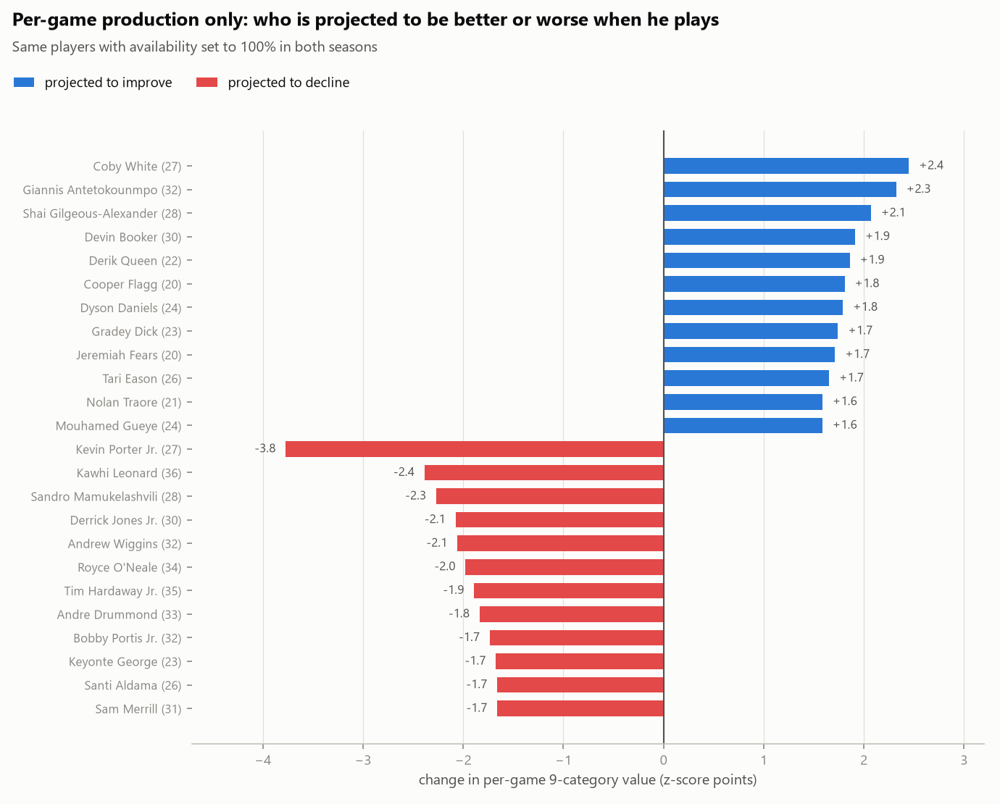

*Figure 48. Biggest changes in per-game value with availability set to 100% in both seasons.*


7 of the 12 per-game risers are 24 or younger and 8 of the 12 per-game fallers are 30 or older: once availability is out of the picture, the age signal dominates.


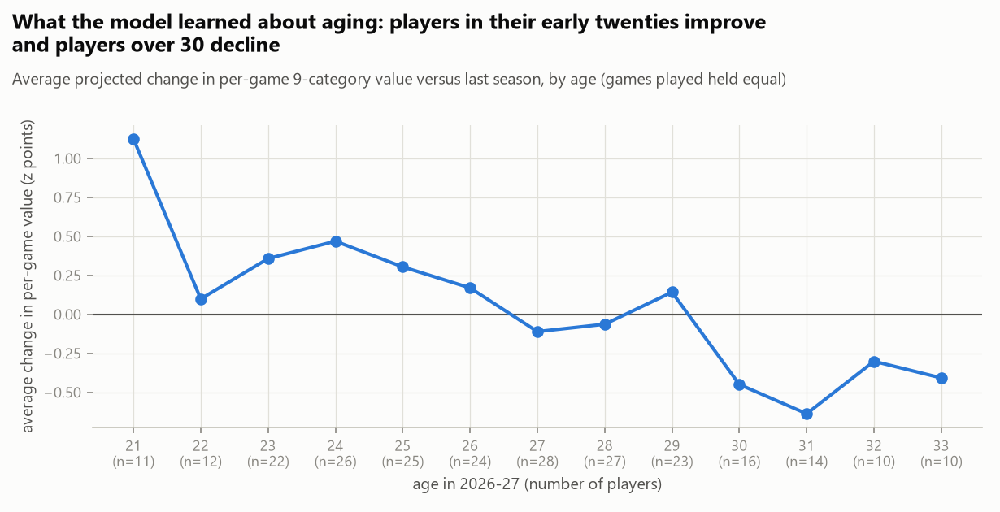

*Figure 49. Average projected change in per-game value by age.*


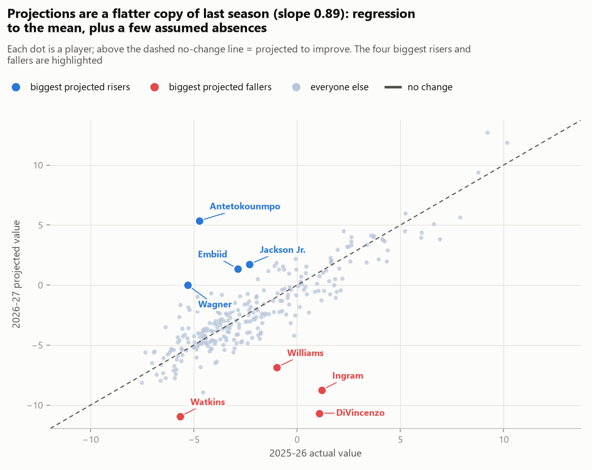

*Figure 50. Projected versus last season's value: the slope below one is regression to the mean.*


Three forces are visible: availability (returning players are projected to play more, which mostly moves the total-value list), aging (learned from the data, not imposed: young players gain and players past 30 lose), and regression to the mean (last season's outliers are pulled toward what comparable players sustain; the fitted slope of 0.89 summarises it, although a few players far below the line, such as the labelled fallers, are there because of assumed absences rather than regression). These are projected *averages*, not predictions of any specific event: a faller is not predicted to be bad, and a riser is not guaranteed to improve.

# 13. Conclusion

## 13.1 What was built

A three-phase system that, for a specific 10-team, 9-category, head-to-head league, recommends at every pick which of the top-200 players gives the best chance of winning weekly matchups: **(1)** projections of every player's 2026-27 per-game statistics built from a shrinkage baseline plus learned corrections and a careful treatment of availability, roster context, rookies and documented expert inputs; **(2)** a simulation that turns each projection into a distribution of weeks on the real calendar, including the three playoff weeks; and **(3)** a draft engine and a category-aware pick policy that play out the rest of the draft and choose the player who maximises the probability of taking at least five of nine categories. Each phase was tested on seasons it had not seen.

## 13.2 Summary of the findings

**Projections (Phase 1).**

* On 1,668 out-of-sample player-seasons (walk-forward folds 2021-22 to 2025-26; 1,644 of them have a previous season to compare with) the projections reduced mean absolute error against "same as last year" in all nine categories (by 5% to 24%); the average rank correlation with true fantasy value was **0.675** against **0.619** for last year's production, and the projection ranked better in all five seasons.
* The learned corrections reduced squared error against the shrinkage baseline most for minutes (-18%), 2-point attempts (-15%), availability (-11%) and free-throw attempts (-10%); rebounds, steals and free-throw percentage stay with the simple shrinkage baseline.
* Residuals were close to zero on average, with mild regression to the mean at the extremes and a heavy upper tail (breakouts and sudden role increases); the extremes are role changes rather than smooth noise. The misses are strongly correlated across categories (0.6 to 0.8 between the minutes miss and the misses in points, rebounds, assists, threes and turnovers), so most of what the model gets wrong about a player is his role.
* **Availability was the largest source of error and the biggest conceptual correction**: counting games only after a player's first appearance, treating known absences as inputs, and using the mean for ranking but the median for display.
* Team context improved projections overall (out-of-sample squared error +1.4% higher on average, and +1.3% for games played, when it is removed), so it was kept; third-year corrections were small and not adopted.

**Simulation (Phase 2).**

* The library reproduces projected means once the make rates are mean-matched (a check found points 1.8% and threes 4.2% too high before the fix; after it both are within 0.1%).
* Tested on four past seasons (5,040 team-weeks), simulated weekly totals are about 5% too narrow overall (the 2024-25 and 2025-26 seasons noticeably so), the dependence between categories is reproduced (mean correlation +0.30 simulated against +0.33 real), and simulated matchup probabilities are close to observed win rates (calibration slope 0.95, Brier 0.218 against 0.244 for always saying 50%). The simulation slightly understates how much top-heavy rosters win and how well real rosters shoot free throws.

**Draft decisions (Phase 3).**

* On the first complete validation (2022-23 to 2025-26, 96 drafts) the engine looked better inside its own simulation (+3.6 points of weekly win probability) than on real box scores (−0.8 ± 1.7); a guard against noisy near-ties repaired most of that (+2.5 ± 1.3 on the same drafts, +3.4 over all five seasons).
* The category-aware policy (4,200 simulated weeks, six candidates per pick, 0.5-point guard) averages **+5.2 points (standard error 1.2, t = 4.2, positive in 5 of 5 seasons)** above "take the best player left" on real 2021-22 to 2025-26 box scores; the previous setting averaged +3.6, the guarded engine +3.4 and the unguarded engine -0.8 (four seasons). On fresh simulated drafts the final setting beat the previous one by +0.63 ± 0.12 points. Over an 18-week regular season a gain of about 5 points of weekly win probability is roughly +0.9 wins.
* Considering every player up to rank 200 does not improve picks, and doing so with an unguarded rule makes them worse.

**The board against the market.** Rank correlation 0.75; median gap 25 places; agreement is best at the top (the market's top four are our top four). Inside the market's top 30 the board is lower on Trae Young, LaMelo Ball, Josh Giddey, Jayson Tatum, Domantas Sabonis, Jalen Brunson, Austin Reaves, Tyrese Haliburton, Cooper Flagg, Alperen Sengun, partly because of projected games and minutes and partly because of category fit. Beyond the top 30 it is lower on players it projects for few minutes or games (Porziņģis and Ingram because of known absences; Kessler, Edey, Harper, Jerome, Dëmin and others because of projected minutes) and higher on role players with steady minutes and steals (Wallace, Suggs, Camara, Sheppard, Pritchard, Edgecombe). Giannis Antetokounmpo, who started the investigation at 93rd, ends at 6th, level with the market, after three separately justified adjustments.

## 13.3 Where we reconsidered the model

| Issue | What we saw | What we did | Result |
|---|---|---|---|
| Availability definition | Players known to be out at tip-off looked like random injuries; games seemed under-projected | Availability since first appearance; known absences as an input; returner blend | Mean bias of −1.0 games (−2.7 for players who changed teams, −2.3 for age 33+); stars returning handled explicitly |
| Mean versus median games | Games are left-skewed | Mean for ranking, median and P25-P75 for display | Same ranking quality (Spearman ρ = 0.996 between the two boards) |
| Team context | Context moved Powell's and Murray's projected games down by 5-6 | Ablation in the backtest | Context helps (error +1.3% for games, +1.4% on average without it); kept |
| Third-year players | Under-projected by about 0.4 points and 0.6 minutes | Season-of-career flags | Small trim, no accuracy gain; not adopted |
| Giannis | Ranked 93rd, then 103rd | Treated 2025-26 as a rest year; switched off his context penalty; floored each category's z-score at −3 | 103rd to 59th, then 29th, then 6th; the floor changes no one else in the top 150 |
| Punting | Hypothesis that his weakness could be exploited | Experiment | A balanced roster won more weeks; not adopted |
| Simulation shooting bias | Points +1.8%, threes +4.2% above projections | Mean-matching of the make rates | Within 0.1% after the correction |
| Absence share in the simulation | Real weeks piled in the lowest and highest 10% buckets (15.8% and 15.2% in 2025-26) | Re-measured the whole-week absence share over every week for every rotation player (0.42 to 0.68) | Reproduces the real 18-21% zero-game weeks and roughly halves the distance from a flat histogram |
| First engine | +3.6 in simulation, −0.8 on real seasons | Guard against noisy near-ties | +2.5 on the same real drafts |
| Policy tuning | More candidates seemed better | Held-out and fresh-seed tests; winner's-curse awareness | Six candidates, 200 draws, guard 0.005 |
| Interim result | An early lead for the policy over the engine | Waited for the full run | The lead vanished: the two are equal within noise |
| Haliburton | Model minutes 26.3 after a missed season | Owner's 29.8-minute override with per-minute rates fixed | Board rank 62 to 35 |

## 13.4 Limitations

* **Five real seasons of validation.** Within a season, mock drafts share the same real outcomes, so the effective sample is five seasons; that is enough to rule out a large harm but too few to measure a small gain precisely. The calibration of the simulation was fitted on all seasons, so the replay is not strictly out of sample for it.
* **Simulated comparisons share one model.** Held-out simulations guard against fitting noise, but they cannot reveal errors in the projections themselves.
* **The market is not truth.** No historical ADP was available, so we cannot say whether the market or the model would have been closer in past seasons.
* **Known structural gaps.** The simulation's weekly spread is about 5% narrow (more in recent seasons) and it slightly understates top-heavy rosters and free-throw shooting; projected probabilities are about 5% too extreme. Position eligibility is approximate; there is no model of injuries by type, of depth charts, or of in-season management (waivers, trades, injured-reserve use), by design.
* **Small samples in subgroup tests.** The returner results rest on 24 players with at least 500 minutes after a missed season (12 former rotation stars) and 94 returner-seasons with at least one game; they support the model's direction, not its precision for any one player.

## 13.5 Future work

The role-focused agenda (returning from injury, roster change, positional depth) is developed, with a first look at the data, in section 14. Beyond it: include historical ADP to compare the model's accuracy with the market's; add playoff qualification to the objective; widen the weekly spread, perhaps by season-level variability in absences; investigate the free-throw and star-premium biases; give returners an injury-type feature if reliable data can be sourced; and download seasons before 2015-16 so that the walk-forward backtest can cover more test years.


# 14. Next steps: areas to explore

This report treats a player's *role* (how many minutes he plays and how many possessions he uses) as something to be inferred from his past minutes, his age, and a handful of team-context features. That choice is where most of the remaining error sits: in section 4.5 the misses in points, rebounds, assists, threes and turnovers were all strongly correlated with the miss in minutes (0.6 to 0.8), and the largest disagreements with the market in section 11 were about playing time. The most promising next steps therefore concern **role**. This section takes the three questions the project owner raised, gives a first look at what the data already say about each, and then lists further recommendations, a protocol for testing them, and some questions.

**How to read the first-look results.** They are exploratory descriptive analyses of the same 2015-16 to 2025-26 box scores, run for this section; none of them changes the 2026-27 board. *Usage* is the standard box-score estimate USG% = 100 × (FGA + 0.44 FTA + TOV) × (team minutes ÷ 5) ÷ (player minutes × team possessions used), where the team's possessions used are FGA + 0.44 FTA + TOV. Position groups are the three buckets (G, F, C) of the API's position label, so every positional result is approximate. Standard errors (SE) are clustered by team-season (or by player where noted), and the intervals shown in the figures are 95%. Many things were looked at, none was corrected for multiple comparisons, and the observational design cannot separate cause from selection: treat each result as a hypothesis worth a proper test (section 14.5), not as a finding.

## 14.1 Question 1: role and usage after a layoff

**What the model does now.** For a player with no games in the previous season, availability is a 50/50 blend of the model and the recency baseline, and minutes are cut by what the model has learned from blank last-season slots (for former rotation stars, 33.1 to 26.5 minutes; section 5.4). Per-minute rates are kept, so counting statistics scale with minutes. For Haliburton the owner's 29.8-minute override followed exactly this logic (section 7.2).

**Questions.** When a rotation player comes back, does his *role* change (fewer minutes, fewer possessions per minute) or only his *exposure*? How long does the ramp-up last? Does the answer depend on how long he was out?

**First look.** Three groups of rotation players (at least 24 minutes per game in the last season in which they played) who then played at least 500 minutes: players who missed a whole season, players who played less than half of the team's games (at least 8) the season before, and healthy controls (at least 80% of games). Each is compared with his own last known season; the controls show the ordinary regression of a high-minutes group toward the average.

| group | players | age | last known MPG | Δ minutes | Δ usage (points) | Δ points per 36 |
|---|---|---|---|---|---|---|
| healthy (control) | 1100 | 27.8 | 30.3 | -1.2 (SE 0.1) | +0.2 (SE 0.1) | +0.3 (SE 0.1) |
| partial season | 107 | 27.7 | 29.7 | -2.7 (SE 0.5) | -1.0 (SE 0.3) | -0.2 (SE 0.3) |
| missed a season | 16 | 28.3 | 31.7 | -6.1 (SE 1.5) | -0.4 (SE 0.8) | -0.8 (SE 0.7) |

Adjusting for age, age squared and last known minutes, and measuring each returner's change *relative to the healthy control*:

| change relative to the healthy control | partial season | missed a season |
|---|---|---|
| minutes per game | -1.59 (SE 0.56) | -4.77 (SE 1.38) |
| usage (USG% points) | -1.20 (SE 0.33) | -0.54 (SE 0.69) |
| points per 36 | -0.47 (SE 0.33) | -0.98 (SE 0.65) |
| assists per 36 | -0.20 (SE 0.10) | -0.02 (SE 0.23) |
| turnovers per 36 | -0.19 (SE 0.07) | +0.09 (SE 0.09) |
| true shooting | +0.012 (SE 0.005) | -0.009 (SE 0.007) |


*Figure 51. Left and centre: change in minutes and usage from the last known season for rotation players who missed a season, played part of one, or stayed healthy. Right: minutes (bars) and possessions per 36 (dots) in the first games after a layoff of 15 or more team games, as a share of the player's own steady level in games 21-40.*


* **After a missed season the role shrinks through minutes, not through usage.** The 16 rotation players who missed a whole season lost 6.1 minutes per game (4.8 more than controls after adjustment, SE 1.4), consistent with the cut already built into the model (section 5.4). Their usage changed by -0.5 points relative to controls (SE 0.7) and their points per 36 by -1.0 (SE 0.7), neither distinguishable from zero, which supports projecting a returner at his old per-minute rates with fewer minutes. The sample is small (16), so this is a consistency check, not a measurement.
* **After part of a season the usage rate also falls.** The 107 players who played part of a season lost 1.6 more minutes than controls (SE 0.6) and 1.2 more points of usage (SE 0.33); per-36 turnovers also fall (-0.19 (SE 0.07)). Plausible reasons (teammates took on their shots while they were out; a more cautious return; or an injury that was already affecting them before they left) cannot be told apart with box scores.
* **The ramp-up lasts about ten games and is the same whatever the layoff.** Across 170 returns after at least 15 missed team games, minutes are 74% of the player's steady level in his first three games, 90% in games 4-10 and 96% in games 11-20, while possessions per 36 minutes stay at 102%, 101% and 97%. The first-three-game figure is 74% after layoffs of 15-20 games, 75% after 21-30 and 71% after 31 or more, and 74% for returns at the start of a season against 74% mid-season. Altogether a return costs about **1.9 games' worth of minutes**. His steady level equals his pre-layoff minutes (median ratio 1.00, n = 43), so the loss is temporary for those who get back.

**What it suggests.** (i) Keep per-minute rates for returners and cut minutes (as now); (ii) count about two fewer games of minutes for any player projected to start the season out or to return mid-season, a small adjustment (about 3% of a 65-game season) that is not modelled explicitly today and is only implicit in the average minutes of past players who missed games; (iii) check whether the minutes uncertainty for returners in the simulation is wide enough, since the talent draw depends on experience only (section 9.2); (iv) look for role signals beyond minutes for players who return after a partial season.

**Proposed study.** Add return-specific features (days since last game, number of games missed, minutes in the first games back when available) and test them in the walk-forward backtest on returners only. The binding constraint is sample size: 16 full-season returners and 107 part-season returners since 2016-17. Downloading the five seasons before 2015-16 would add about half again (this needs the project owner's yes). The most valuable missing information is the *type* of injury and the stated timeline (the database's `player_absence` table is empty); the ESPN injury report gives only the current designation.

## 14.2 Question 2: how roles evolve as the roster changes

**What the model does now.** The team-context features (section 6) give each player the minutes and possessions *vacated* by departed teammates and *incoming* from arrivals, overall and for his own position group. The backtest showed that they help most for players who changed teams (points error -7%) and leave stayers unchanged (within 0.7%).

**Questions.** Does a stayer's usage and minutes respond to what left? Is it the *amount* of vacated role or the *type* of player who left? And inside a season, when the team's top-usage player is out, who gets his minutes and possessions?

**First look (offseason changes).** 1,891 rotation players (15+ minutes, 30+ games) who stayed with their team, 300 team-seasons. Outcome: change in usage and minutes from last season. Total vacated possessions (as a share of last year's team possessions) do not predict usage (+0.014 (SE 0.044) points per 10 points of vacated share) and the minutes coefficient has the opposite of the expected sign (-0.115 (SE 0.062)). Splitting the departures by *type* changes the picture: possessions vacated by high-usage players (24+ USG%, about 26% of rotation players) raise a stayer's usage by +0.26 (SE 0.07) points per 10 points of team possessions, and his points per 36 by +0.19 (SE 0.06), while possessions vacated by other rotation-level players have no positive effect (-0.08 (SE 0.05)). The usage of players whose teams lost a high-usage player (44% of stayers) rose on average by 0.40 points (one such departure) and 0.70 points (two or more), against -0.20 when no rotation-level player left and -0.18 when only lower-usage players left. Minutes barely move (+0.01 (SE 0.10) per 10 points): the extra shots come from a larger share of the same minutes.


*Figure 52. Left: average change in a stayer's usage by what left his team. Right: the adjusted extra usage when a high-usage player left, by the stayer's own usage rank.*


The effect is not concentrated in the team's top option: the adjusted gain is +0.73 (SE 0.35) points for the highest-usage player, +0.56 (SE 0.24) for the second and third, +0.14 (SE 0.20) for the fourth to sixth and +0.59 (SE 0.34) below that.

**First look (inside a season).** For each of 181 team-seasons we take the team's top-usage player (who played for that team all year) and compare his teammates' minutes and possessions in the games he missed (median 14 games) with the games he played, counting a missed game as zero so that the changes add up. Teammates pick up 79% of his minutes and 82% of his possessions (the rest goes to players who arrived or left, or to players absent in the same games). The next four players by minutes pick up 12% of the possessions but lose 13% of the star's minutes in total because the other starters are also more likely to be out in those games; the rotation players (5th to 8th) pick up 29% of the possessions and the deep bench 42%.


*Figure 53. Share of the star's minutes and possessions picked up by teammate group when the team's top-usage player is out.*


**What it suggests.** Role is not a fixed quantity that a roster change merely rescales: *who* leaves matters more than *how much* leaves. The current context features add up vacated and incoming role without regard to usage; a usage-weighted version (for example possessions vacated by players above a usage threshold, and the incoming usage of arrivals) is a cheap candidate that uses data already in the database. Inside a season, absences appear to cluster (the other starters lost minutes in the games the star missed), so the independent absences in the simulation (section 9.2) may understate how often several starters miss the same week, and the redistribution of a star's possessions to the bench is something a pure season-average projection cannot show.

**Proposed study.** (1) Add usage-weighted vacated and incoming features and compare walk-forward error for stayers and movers separately; (2) model usage × minutes × efficiency as separate pieces instead of per-36 rates alone; (3) add team-level random effects (a hierarchical model) so that each team's rotation habits are partially pooled; (4) the database has empty `coach` and `team_era` tables: coach changes are a likely driver of rotation changes and would need a data source; (5) test a team-level absence correlation in the simulation (section 14.4).

## 14.3 Question 3: how positional depth affects output

**What the model does now.** The context features include vacated and incoming role *at the player's own position group*, and a lineup rule with a three-center cap in the draft simulation. They do not include how crowded the position is with teammates who stayed.

**Questions.** Do the departure or arrival of players at one's own position matter more than elsewhere? Beyond what the projection already knows, do players with more same-position competition play less or produce less?

**First look.** (a) *Stayers.* For the same 1,891 stayers, the minutes change per 10 points of team possessions vacated by same-position departures is +1.25 (SE 0.36) for centers (n = 261), against -0.13 (SE 0.13) for guards and -0.05 (SE 0.13) for forwards; possessions vacated at *other* positions do not help centers (+0.07 (SE 0.10)). (b) *Residuals.* For the 1570 out-of-sample player-seasons of the backtest, we regressed what the minutes projection missed (actual minus projected) on the role minutes last season of same-position teammates who stayed, in full-time-player equivalents of 36 minutes (standard deviation 1.1). Each additional same-position teammate of this kind is associated with -0.44 (SE 0.15) minutes per game (R² 1%); for other-position teammates the association is smaller (-0.16 (SE 0.14)).


*Figure 54. Left: change in a stayer's minutes per 10 points of team possessions vacated by same-position versus other-position departures, by position group. Right: what the walk-forward minutes projection missed, by the same-position depth of the team.*


By position group, the change in each quantity per additional full-time same-position teammate (each cell is the coefficient and its standard error; minutes was the outcome looked at first, the others are descriptive):

| position group | n | minutes | points | rebounds | assists | blocks |
|---|---|---|---|---|---|---|
| Guards | 757 | -0.54 (SE 0.24) | -0.13 (SE 0.21) | -0.05 (SE 0.04) | -0.17 (SE 0.06) | -0.01 (SE 0.01) |
| Forwards | 614 | -0.11 (SE 0.24) | -0.22 (SE 0.16) | -0.09 (SE 0.05) | -0.02 (SE 0.04) | +0.01 (SE 0.01) |
| Centers | 199 | -1.31 (SE 0.69) | -0.98 (SE 0.39) | -0.47 (SE 0.24) | -0.08 (SE 0.10) | -0.09 (SE 0.05) |

* **Guards** projected on a deep team lose about half a minute per extra guard-sized role and about 0.17 assists per game; the gap between the least and the most crowded quarter of guards is 1.4 minutes per game (right panel).
* **Centers** have the largest but also the noisiest effect (n = 199): 1.3 minutes, 1.0 points and 0.5 rebounds per game per additional full-time center, and the same pattern in the stayers' regression. A team seldom has two full-time centers, so the sample of crowded situations is small.
* **Forwards** show no clear relationship (-0.11 (SE 0.24) minutes). The forward label is the broadest of the three buckets and the least informative.

**What it suggests.** There is a modest, interpretable signal that the projection misses: competition at one's own position lowers minutes and the counting statistics that follow from them, and vacated positional minutes lift centers. The effect is small against the typical minutes miss of 4.2, so it would improve rankings only slightly, but it is cheap to add and bears directly on a league with a three-center cap. All of it rests on three coarse position buckets; with exact ESPN eligibility (blocked from the development machine) a sharper definition (PG, SG, SF, PF, C, and multi-position players) could be tested.

**Proposed study.** Add a positional-crowding feature set (same-position and other-position role minutes of stayers and of arrivals) to the minutes and attempts models, run the walk-forward backtest with and without it, and use the ranking correlation and the real-season draft validation of section 10.7 as the final tests. Because positions are fluid, a data-driven alternative is to describe each player by his own profile (rebounding, assists, rim protection per 36) and measure crowding by *similarity of profile* instead of position label.

## 14.4 Other recommendations

| Priority | Idea | Why | Data needed | First test |
|---|---|---|---|---|
| 1 | Usage-weighted vacated and incoming features | Who leaves matters more than how much (14.2) | In the database | Walk-forward error for stayers and movers; ranking correlation |
| 1 | Returner ramp-up in the availability model | About two game-equivalents of minutes lost per return (14.1) | In the database | Effective-availability error for returners; simulation check |
| 2 | Positional crowding features | Minutes and counting stats fall with same-position competition (14.3) | In the database (coarse positions); ESPN eligibility would sharpen it | Minutes and attempts models, with and without |
| 2 | Role uncertainty in the simulation: wider minutes spread for returners, movers and rookies, and correlated team-level absences | Absences appear to cluster (14.2); the talent spread depends only on experience (section 9.2); the realism test found the spread about 5% too narrow and top-heavy rosters under-credited (section 9.6) | In the database | Probability-integral-transform histograms by group; weekly spread |
| 2 | Starter versus bench flag and role-change events | A move from the bench to the starting five is a bigger change than the minutes alone show | Starting lineups (an additional download; needs a yes) | Feature in the minutes model; subgroup error |
| 3 | Injury type, severity and return timeline for returners | The main thing the box scores cannot tell us | External source (the `player_absence` table is empty) | Returner error; needs more seasons to be testable |
| 3 | Historical average draft position | To learn whether the market or the model is closer in past seasons, and whether blending them helps | External archive | Rank correlation with realised value, by year |
| 3 | Earlier seasons (2010-11 to 2014-15) | More returners, more test folds, more seasons for the real-season validation | Download (needs a yes) | Re-run the backtest and the validation |
| 3 | Preseason signals (preseason minutes, coaching changes, contract status) | Roles are announced before they show up in regular-season box scores | External sources | Feature in the minutes model, for the owner's draft date |

## 14.5 A protocol for testing any of these ideas

Each idea should pass the same sequence that the existing model passed: (1) state the primary metric before looking (for role features: the out-of-sample squared error of minutes and of attempts, and the Spearman ranking correlation with realised value); (2) add the feature to the walk-forward backtest (folds 2021-22 to 2025-26, refitting everything inside each fold) and compare with the current model on identical player-seasons; (3) report subgroup results where the idea should help (returners, movers, centers) *and* where it should not, to catch accidental gains; (4) correct for the number of ideas tried, because the best of several is biased upward (the winner's curse of section 10.5); (5) only then rebuild the board and, for changes that move many players, rerun the real-season mock-draft validation of section 10.7. A feature that improves the ranking by much less than its season-to-season variability (the model's Spearman correlation ranged from 0.56 to 0.75 across the five test seasons) should be adopted only if it is simple and interpretable.

## 14.6 Questions for the project owner

1. **Priority.** Do you want the first round to be the two data-in-hand items (usage-weighted context, returner ramp-up), which could be tested within a day, or a larger rebuild around role (usage × minutes × efficiency, with team-level effects)?
2. **Downloads.** May I download (a) starting-lineup flags and (b) the 2010-11 to 2014-15 seasons? Both enlarge the sample for role questions but add data to the repository's database; each needs your yes.
3. **Injury information.** Can you obtain injury types or return timelines for the returners you care about (for example from the team reports you read before drafts)? Even a short manual list would let us test whether return minutes depend on injury type.
4. **Risk preference.** The pick policy maximises the chance of winning a week. Do you want a more volatile roster (high-minutes-uncertainty players such as returners) or a steadier one? The role-uncertainty work in 14.4 would let us offer that choice explicitly.
5. **Scope.** Is the project still draft-only? Several findings in 14.2 (the bench picking up a star's possessions) matter most for in-season pickups, which are out of scope by your instruction; I would keep them in this section as findings and not build on them unless you widen the scope.
6. **Positions.** Can you paste or export exact ESPN position eligibility from a machine that is not blocked? It would make the positional work in 14.3 much sharper.

# References

**Statistical methods**

1. Efron, B. and Morris, C. (1975). Data analysis using Stein's estimator and its generalizations. *Journal of the American Statistical Association*, 70(350), 311-319. (Shrinkage toward a prior mean, illustrated with baseball batting averages: the idea behind section 3.)
2. James, W. and Stein, C. (1961). Estimation with quadratic loss. *Proceedings of the Fourth Berkeley Symposium*, 1, 361-379.
3. Gelman, A., Carlin, J., Stern, H., Dunson, D., Vehtari, A. and Rubin, D. (2013). *Bayesian Data Analysis* (3rd ed.). CRC Press. (Beta-binomial and empirical-Bayes estimation of proportions.)
4. Hoerl, A. and Kennard, R. (1970). Ridge regression: biased estimation for nonorthogonal problems. *Technometrics*, 12(1), 55-67.
5. Ke, G. et al. (2017). LightGBM: a highly efficient gradient boosting decision tree. *Advances in Neural Information Processing Systems*, 30.
6. Koenker, R. and Bassett, G. (1978). Regression quantiles. *Econometrica*, 46(1), 33-50.
7. Hastie, T., Tibshirani, R. and Friedman, J. (2009). *The Elements of Statistical Learning* (2nd ed.). Springer. (Cross-validation, ridge regression, boosting; the caution about selecting a model with the data used to evaluate it, relevant to section 10.5.)
8. Nelsen, R. (2006). *An Introduction to Copulas* (2nd ed.). Springer. (Gaussian copula used in section 9.)
9. Dawid, A. P. (1984). Statistical theory: the prequential approach. *Journal of the Royal Statistical Society A*, 147(2), 278-292. (The probability-integral transform as a calibration check, section 9.6.)
10. Brier, G. (1950). Verification of forecasts expressed in terms of probability. *Monthly Weather Review*, 78(1), 1-3.
11. Hyndman, R. and Athanasopoulos, G. (2021). *Forecasting: Principles and Practice* (3rd ed.). OTexts. (Time-series cross-validation: the idea of the walk-forward backtest, section 4.2.)

**Data and software**

12. NBA statistics API accessed through the `nba_api` Python package (S. Patel et al.): endpoints `LeagueGameLog`, `PlayerIndex`, `LeagueDashPlayerBioStats`, `ScheduleLeagueV2`. Data © the NBA; used here for personal, non-commercial analysis.
13. ESPN injury report, espn.com/nba/injuries, read 14 October 2026 (players with an "Out" designation).
14. Yahoo Sports draft-class projections for rookies and the blended average-draft-position workbook (Yahoo, ESPN, Fantrax) dated 14 October 2026, supplied by the project owner; used for comparison only.
15. Software: Python 3.14, pandas, NumPy, SciPy, scikit-learn, LightGBM, Matplotlib, SQLite, Streamlit.

# Appendix A. Reproducing the results

From the repository root (`github.com/bsyed3/nba-fantasy-draft-helper`, branch `testing`), after creating a virtual environment and installing the requirements:

```
python scripts/ingest.py                 # box scores 2015-16 to latest + the 2026-27 schedule -> data/processed/nba.db
python scripts/build_projections.py      # walk-forward backtest + 2026-27 projections (projections_2026.parquet)
python scripts/build_library.py          # calibration, simulated weeks (21 periods incl. playoffs), policy table
python scripts/validate_draft.py --playoffs --arms adaptive   # mock drafts scored on real seasons 2021-2025
python -m scripts.final_report.build     # this report (Markdown + HTML + PDF) into the report folder
streamlit run src/app/streamlit_app.py  # the draft board
```

Data used by the backtest and the real-season validation never include the season being predicted: the walk-forward loop refits every model on seasons strictly before the test season. Random seeds are fixed in the scripts (e.g. policy table seed 24680, mock-draft seeds in the analysis scripts) so the numbers can be regenerated; the draft-engine experiments are the slow part (minutes to hours each, depending on the number of mock drafts).

# Appendix B. Fitted parameters of the shrinkage baseline

For each statistic the recency decay *d* (weight of a season *l* years back is *d*<sup>l−1</sup>) and prior strength *k* (equivalent number of attempts or minutes of prior information) were fitted by minimising out-of-sample error over the backtest folds.

| statistic | recency decay | prior strength k |
|---|---|---|
| 2-pt attempts /36 | 0.40 | 100 |
| 3-pt attempts /36 | 0.40 | 100 |
| FT attempts /36 | 0.40 | 250 |
| Rebounds /36 | 0.40 | 100 |
| Assists /36 | 0.40 | 100 |
| Steals /36 | 0.60 | 500 |
| Blocks /36 | 0.60 | 250 |
| Turnovers /36 | 0.40 | 250 |
| 2-pt % | 0.40 | 200 |
| 3-pt % | 1.00 | 400 |
| FT % | 0.60 | 50 |
| Minutes per game | 0.40 | 10 |
| Availability (GP / team games) | 0.40 | 40 |

# Appendix C. League settings used throughout

| Setting | Value |
|---|---|
| Platform and format | ESPN, snake draft, 10 teams, 13 rounds |
| Scoring | Head-to-head, 9 categories: PTS, 3PM, REB, AST, STL, BLK, FG%, FT%, TO (lower is better) |
| Win rule | A week is one win if a team wins more than 4.5 of 9 categories; margins are ignored |
| Season | 18 regular-season weeks + 3 playoff weeks (21 scoring periods) |
| Lineup | Daily; PG, SG, G, SF, PF, F, C, 3 UTIL; 3 bench; 1 IR; at most 3 centers |
| Management in scope | Draft only; no waivers, trades or free-agent pickups |
| Candidate pool | The top 200 players on the projection board |

# Appendix D. Glossary

* **ADP (average draft position).** The mean pick number at which a player is selected in many drafts; the *market order* ranks players by this value.
* **Availability.** Games played divided by the games a team played while the player was on its roster (after his first appearance), adjusted for known absences.
* **Backtest, walk-forward.** Repeatedly fit on seasons up to year *t*−1, predict season *t*, and score the prediction against what happened; moving *t* forward gives out-of-sample errors for several seasons.
* **Copula.** A way of attaching a dependence structure (here Gaussian) to variables whose individual (marginal) distributions are chosen separately.
* **Empirical Bayes / shrinkage.** Estimating each player's rate as a weighted average of his own data and a population prior, with the weight set by how much data he has.
* **Guard (margin).** A rule that the engine only departs from the board's best available player when its estimated win probability is higher by more than a stated amount.
* **MAE, RMSE.** Mean absolute error and root-mean-squared error of a prediction.
* **PIT (probability-integral transform).** The percentile of an observed value within its predicted distribution; uniform if the forecasts are calibrated.
* **Residual.** Actual minus projected value.
* **Roll-out.** Playing out the remainder of a draft (and the season) in simulation after a candidate pick to estimate how well it works.
* **Spearman correlation.** The correlation of the ranks of two sets of values; 1 means the same order.
* **z-score.** A value expressed in standard deviations from the mean of the player pool; the 9-category *value* is the sum of the nine z-scores (with turnovers reversed).
